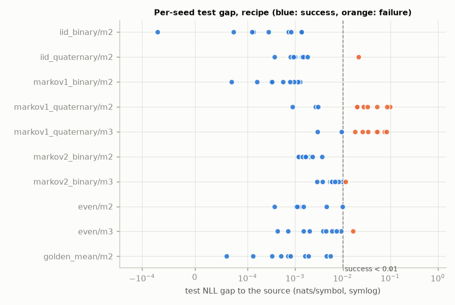
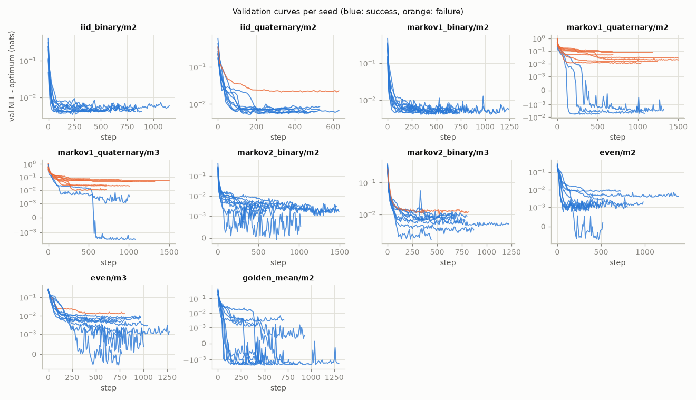
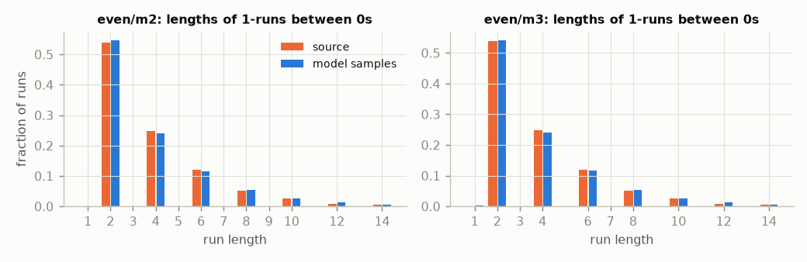
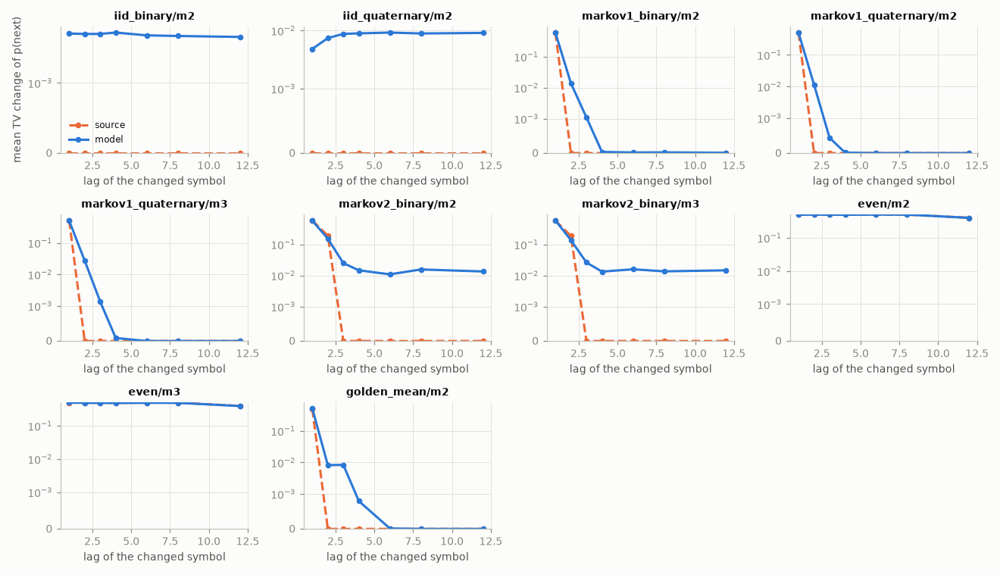
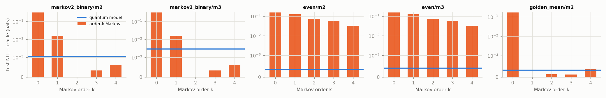
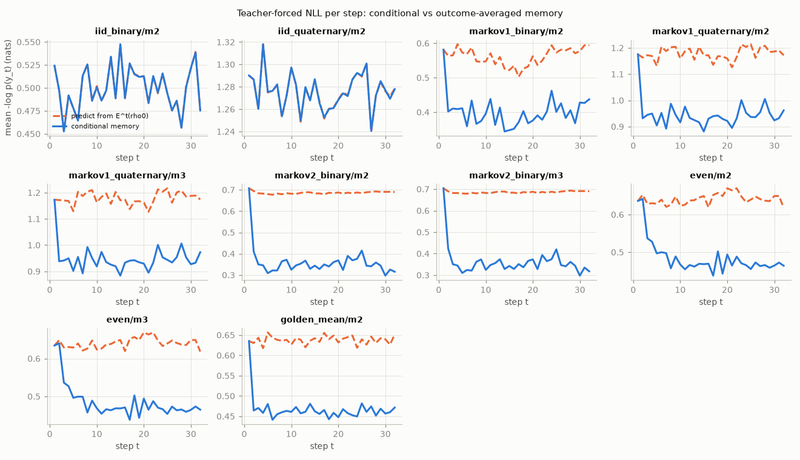
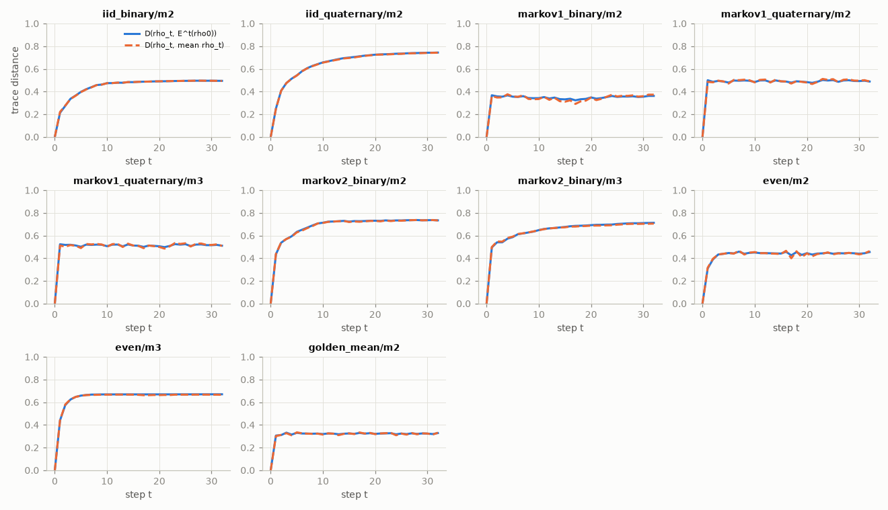
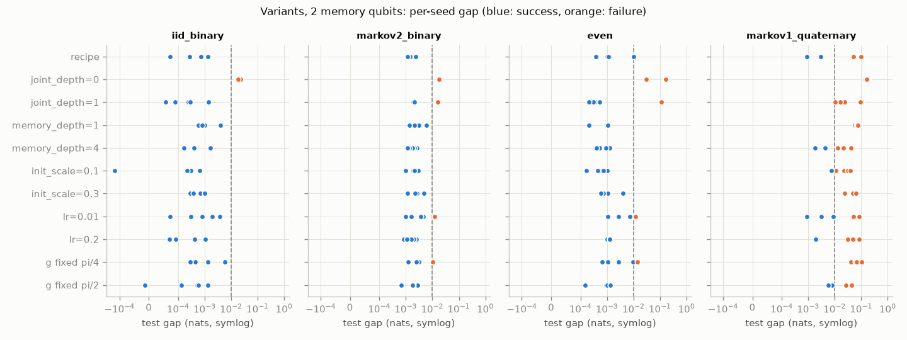

# Phase 2 results: a working measurement-conditioned generator

Issue #5, part of the campaign in issue #2. This covers architecture A only: one
trainable instrument per step, the outcome is the symbol, and the memory keeps the
outcome-conditioned state. Ablations, baselines and strength sweeps are Phase 3.

All the numbers below come from one command:

```sh
uv run python experiments/phase2.py --config experiments/configs/phase2.toml
```

The full generated tables are in [`results/summaries/phase2/summary.md`](../results/summaries/phase2/summary.md)
(with `main.csv`, `variants.csv` and `summary.json`). The raw per-run records,
including curves, `run_metadata` and trained parameters, go to
`results/phase2/<timestamp>/` (gitignored). The training took about 144 CPU-minutes
in total, about 21 minutes wall time with 7 worker processes on an Apple-silicon
laptop. If a run is interrupted, `--from-run <dir>` trains only the missing runs.
The commits recorded in the runs (`6419e22`, `51db155`) are SHAs from the issue
branch before it was rebased onto the literature review (#4). The rebase changed
only `docs/literature-review.md` and `docs/references.bib`, so the code that produced the runs is the same.

## 1. Setup

**Tasks** (`qmem.tasks`). Every source is a finite HMM with labelled transition
matrices, so one forward algorithm gives the sampler, the exact Bayes-optimal
predictive `p(y_t | y_<t)` and the source's own log-probabilities. The exact
finite-T optimum `H(Y_1..Y_T)/T` comes from enumerating belief states. All sources
start from their stationary distribution.

| task | definition | memory it needs |
|---|---|---|
| `iid_binary` | p = (0.8, 0.2) | none |
| `iid_quaternary` | p = (0.4, 0.3, 0.2, 0.1) | none |
| `markov1_binary` | p(1\|0) = 0.1, p(1\|1) = 0.7 | 1 symbol |
| `markov1_quaternary` | 4×4 table (one row has two zeros) | 1 of 4 symbols |
| `markov2_binary` | p(1 \| y_{t-2} y_{t-1}) = 0.1, 0.8, 0.4, 0.9 for 00, 01, 10, 11 | 2 symbols |
| `even` | Even process, p = 1/2 | parity of the current run of 1s (infinite Markov order) |
| `golden_mean` | no two consecutive 0s, p = 1/2 | 1 symbol |

The tests check each optimum against brute-force enumeration of every sequence (via
the chain rule), against long-sample estimates, against the analytic entropy rates,
and check the sampler against the predictive (`tests/test_tasks.py`).

**Data.** The splits are fixed from `data.seed = 0`: 512 train, 256 validation and
512 test sequences of length 32. Their seeds are recorded in every run.

**Metric.** The main metric is the *gap*: model test NLL minus the source's own NLL
on the same test sequences, in nats per symbol. Its expectation is the per-symbol
KL divergence, and because it is paired it has a much smaller standard error than
a comparison with the expected optimum (both numbers are reported). A run **fails**
if it crashed, diverged, or has a gap of at least 0.01 nats/symbol (0.014 bits).
Means, standard errors and 95% bootstrap CIs are taken over all seeds, failures
included.

**Recipe** (`[model]` and `[train]` in the config). It uses 2 memory qubits
(3 where noted), 1 output qubit for binary tasks and 2 for 4-symbol tasks, and no
env ancillas. The circuit is `memory_depth = 2` hardware-efficient layers on the
memory (RY, RZ, linear CNOT), then the controlled-RY(2g) coupling with trainable
`g` (initialised at π/4), then **`joint_depth = 2`** layers on memory plus output.
`init_scale = 1`. Training uses Adam with lr 0.05 (constant), batch 128, at most
1500 steps, validation every 10 steps, early stopping after 30 evaluations without
an improvement of at least 1e-4, and restores the best-validation parameters. There
is no gradient clipping, but the pre-clip norm is logged every step. `prob_floor`
is off, and the tiny and zero p(y) counters were zero in every run. The recipe was
run with 10 model seeds per task and memory size.

## 2. Main results

Columns: exact optimum `H/T`; the source's NLL on this test set (oracle); the
model's test NLL; the gap (mean ± SE over 10 seeds, and its 95% bootstrap CI).

| task | mem qubits | optimum | oracle (test) | model test NLL | gap mean ± SE | gap 95% CI | median gap | failed | accuracy model / oracle |
|---|---|---|---|---|---|---|---|---|---|
| iid_binary | 2 | 0.5004 | 0.4999 | 0.5005 ± 0.0002 | 0.0006 ± 0.0002 | [0.0003, 0.0009] | 0.0003 | 0/10 | 0.800 / 0.800 |
| iid_quaternary | 2 | 1.2799 | 1.2754 | 1.2786 ± 0.0020 | 0.0032 ± 0.0020 | [0.0010, 0.0074] | 0.0013 | 1/10 | 0.403 / 0.404 |
| markov1_binary | 2 | 0.4017 | 0.4007 | 0.4014 ± 0.0001 | 0.0007 ± 0.0001 | [0.0004, 0.0009] | 0.0006 | 0/10 | 0.847 / 0.847 |
| markov1_quaternary | 2 | 0.9456 | 0.9451 | 0.9793 ± 0.0108 | 0.0342 ± 0.0108 | [0.0161, 0.0559] | 0.0199 | **7/10** | 0.590 / 0.606 |
| markov1_quaternary | 3 | 0.9456 | 0.9451 | 0.9859 ± 0.0086 | 0.0408 ± 0.0086 | [0.0250, 0.0561] | 0.0343 | **8/10** | 0.600 / 0.606 |
| markov2_binary | 2 | 0.3686 | 0.3586 | 0.3604 ± 0.0002 | 0.0018 ± 0.0002 | [0.0015, 0.0023] | 0.0016 | 0/10 | 0.869 / 0.869 |
| markov2_binary | 3 | 0.3686 | 0.3586 | 0.3652 ± 0.0008 | 0.0066 ± 0.0008 | [0.0051, 0.0082] | 0.0059 | 1/10 | 0.868 / 0.869 |
| even | 2 | 0.4820 | 0.4847 | 0.4870 ± 0.0009 | 0.0023 ± 0.0009 | [0.0010, 0.0042] | 0.0011 | 0/10 | 0.663 / 0.668 |
| even | 3 | 0.4820 | 0.4847 | 0.4899 ± 0.0016 | 0.0052 ± 0.0016 | [0.0026, 0.0082] | 0.0039 | 1/10 | 0.663 / 0.668 |
| golden_mean | 2 | 0.4675 | 0.4667 | 0.4684 ± 0.0006 | 0.0016 ± 0.0006 | [0.0006, 0.0028] | 0.0007 | 0/10 | 0.668 / 0.670 |

In bits per symbol: the Even process optimum is 0.6954 bits/symbol at T = 32
(entropy rate 2/3), and the 2-qubit model reaches 0.7026 bits on the test set
against the oracle's 0.6993.





### Generation check (`model.sample`, the separate generation path)

For each group we took the seed with the best *validation* NLL, sampled 2000
sequences of length 32, and compared n-gram distributions with 2000 source
sequences. The noise floor is the same distance between two independent source
samples. For every group the 1- to 3-gram TV distances are within 0.015 of the
noise floor (largest: 3-gram TVs of 0.017 against 0.004 for 3-qubit order-2 Markov,
and 0.030 against 0.015 for 3-qubit `markov1_quaternary`). The full table is in
`summary.md`.

**Even process.** Model samples reproduce the run-length distribution of 1s (2, 4,
6, … with the source's frequencies). Odd runs are 0.2% of runs between 0s for the
2-qubit model and 0.4% for the 3-qubit model (the source has none). 15 of the 2000
sampled sequences (0.75%) contain at least one forbidden pattern. So the model has
learnt the constraint very nearly but not exactly: an exact representation would
need some `p(y) = 0`, which a smooth parameterisation reaches only in the limit.



## 3. Memory demonstrations

**Interventions.** On a test prefix of length 24 we change the symbol at lag `l` and
measure the mean total-variation change in `p(next | prefix)`, for the model
(representative seed) and the exact source:

| task | lag 1 | lag 2 | lag 3 | lag 12 |
|---|---|---|---|---|
| iid_binary | 0.006 / 0 | 0.006 / 0 | 0.006 / 0 | 0.005 / 0 |
| markov1_binary | 0.592 / 0.600 | 0.014 / 0 | 0.001 / 0 | 0.000 / 0 |
| markov2_binary (2 qubits) | 0.575 / 0.586 | **0.153 / 0.189** | 0.025 / 0 | 0.013 / 0 |
| even (2 qubits) | 0.496 / 0.500 | 0.498 / 0.498 | 0.497 / 0.497 | **0.400 / 0.400** |
| golden_mean | 0.519 / 0.500 | 0.008 / 0 | 0.008 / 0 | 0.000 / 0 |

For the Even process, prefixes made impossible by the change are excluded from both
averages. The model's dependence on the past matches the source's lag profile:

- **Order-2 Markov:** p(next) depends on the symbol two steps back (0.15 against
  the source's 0.19), and only weakly further back.
- **Order-1 sources:** dependence stops after lag 1.
- **i.i.d.:** there is essentially no dependence (0.006, a residual of imperfect fitting).
- **Even process:** a symbol 12 steps back still changes the prediction by exactly
  as much as it does for the source.

The context tables in `summary.json` give the per-context p(next) for model and source.



**Even process versus finite windows.** These are order-k Markov count models fitted
to the same training split (add-α smoothing, α chosen on validation). Test NLL, nats/symbol:

| model | k=0 | k=1 | k=2 | k=3 | k=4 | quantum, 2 qubits | oracle |
|---|---|---|---|---|---|---|---|
| Even | 0.6407 | 0.6131 | 0.5573 | 0.5426 | 0.5175 | **0.4851** | 0.4847 |
| order-2 Markov | 0.6859 | 0.3751 | 0.3586 | 0.3589 | 0.3592 | 0.3597 | 0.3586 |
| Golden mean | 0.6377 | 0.4667 | 0.4669 | 0.4669 | 0.4671 | 0.4671 | 0.4667 |

On the Even process the 2-qubit model is within 0.0004 nats of the oracle, while the
best order-4 window is 0.033 nats worse. The memory is not just a short window. On
order-2 and Golden-mean data, which a short window solves, the best count model is
as good as the quantum model or slightly better. This is a check, not a baseline
comparison: classical RNN and HMM baselines are Phase 3.



**Conditional versus outcome-averaged memory** (a preview of ablation B, not the
ablation). Along the test trajectories (representative seed) we compare:

- the conditional memory `rho_t`;
- the outcome-averaged memory `E^t(rho_0)` (the same instrument with outcomes discarded);
- the NLL obtained when each symbol is predicted from `E^{t-1}(rho_0)` instead of `rho_{t-1}`.

| task | purity of rho_t | purity of E^t(rho0) | mean D(rho_t, E^t rho0) | NLL conditioned | NLL from E^t(rho0) |
|---|---|---|---|---|---|
| iid_binary | 1.000 | 0.567 | 0.456 | 0.5000 | 0.5000 |
| markov1_binary | 1.000 | 0.674 | 0.349 | 0.4008 | 0.5613 |
| markov2_binary | 1.000 | 0.311 | 0.696 | 0.3597 | 0.6862 |
| even | 1.000 | 0.569 | 0.438 | 0.4851 | 0.6409 |
| golden_mean | 1.000 | 0.768 | 0.322 | 0.4671 | 0.6377 |

- With no env ancillas and a pure `rho_0`, each outcome has a single Kraus
  operator, so the conditional memory stays exactly **pure**: the purity of `rho_t`
  carries no information here. The trace distance to the averaged state carries it.
- Predicting from the outcome-averaged memory gives the memoryless (order-0)
  NLL. For example, Even gives 0.6409 against the k=0 count model's 0.6407. All
  the predictive benefit therefore comes from the outcome-conditioned update.
- On the i.i.d. task the conditional state still differs from the average
  (D = 0.46), but the two predict identically. The memory moves in directions the
  readout ignores, which is the expected form of "history gives no benefit".




## 4. Variants: what matters

These are one-factor changes from the recipe, with 2 memory qubits, 5 seeds and 4
tasks. Entries are the median gap and the number of failed runs out of 5
(full per-seed plot below).

| variant | iid_binary | markov2_binary | even | markov1_quaternary |
|---|---|---|---|---|
| **recipe** (joint_depth 2) | 0.0007 (0) | 0.0015 (0) | 0.0011 (0) | 0.0030 (2) |
| joint_depth = 0 | 0.0174 (5) | 0.0186 (5) | 0.0304 (5) | 0.1658 (5) |
| joint_depth = 1 | 0.0002 (0) | 0.0161 (3) | 0.0004 (1) | 0.0235 (5) |
| memory_depth = 1 | 0.0009 (0) | 0.0021 (0) | 0.0009 (0) | 0.0692 (5) |
| memory_depth = 4 | 0.0004 (0) | 0.0018 (0) | 0.0005 (0) | 0.0127 (3) |
| init_scale = 0.1 | 0.0002 (0) | 0.0019 (0) | 0.0006 (0) | 0.0228 (4) |
| init_scale = 0.3 | 0.0004 (0) | 0.0027 (0) | 0.0010 (0) | 0.0460 (5) |
| lr = 0.01 | 0.0008 (0) | 0.0037 (1) | 0.0026 (1) | 0.0088 (2) |
| lr = 0.2 | 0.0004 (0) | 0.0016 (0) | 0.0010 (0) | 0.0312 (3) |
| g fixed at π/4 | 0.0013 (0) | 0.0029 (1) | 0.0027 (1) | 0.0668 (5) |
| g fixed at π/2 | 0.0005 (0) | 0.0019 (0) | 0.0010 (0) | 0.0259 (3) |



- **`joint_depth` is the factor that matters.** With `joint_depth = 0` (the
  coupling-only readout of Phase 1b) every run on every task failed, including the
  i.i.d. sanity check. The reason is structural: the Kraus operators are then
  `K_y = D_y(g) V`, with `D_y` diagonal on the controlling memory qubit, so outcome
  1 always projects that qubit to `|1>`, and the reachable post-measurement states
  are too constrained to hold a stationary distribution exactly. One joint layer
  fixes the easy tasks; two fix the 2-symbol-memory tasks.
- **The first full run used `joint_depth = 1` and is recorded here as superseded.**
  Its failure counts out of 10 were:

  | task | failed (out of 10) |
  |---|---|
  | iid_binary | 0 |
  | iid_quaternary | 4 |
  | markov1_binary | 3 |
  | markov1_quaternary, 2 qubits | 8 |
  | markov1_quaternary, 3 qubits | 10 |
  | markov2_binary, 2 qubits | 5 |
  | markov2_binary, 3 qubits | 8 |
  | even, 2 qubits | 2 |
  | even, 3 qubits | 4 |
  | golden_mean | 1 |

  Its raw records (`results/phase2/20261105T033230Z`, local) were kept, and its
  variant table is the source of the `joint_depth = 2` choice.
- **Secondary factors.** `memory_depth = 4` and a smaller learning rate helped
  slightly on the hardest task. A small `init_scale` was neither a clear help nor a
  clear harm on the easy tasks and hurt the hardest. Fixing `g = π/4` was worse than
  training it; fixing `g = π/2` was about as good as training it.
- **The learned `g` is not a measurement strength here.** With `joint_depth > 0`,
  learned `g` values range over [-0.24, 1.98] across seeds, and several seeds set
  g ≈ 0, switching the controlled coupling off and reading out through `J` alone.

## 5. Training pathologies

- **No 1/p blow-ups.** No step had `p(y) < 1e-10` or `p(y) = 0`, `prob_floor` was
  never needed, and no run diverged or crashed. Gradient norms stayed below 1.5
  (median about 0.05). One run in 100 had a gradient spike (more than 10× the
  running median).
- **No collapsed instruments.** Every outcome's effect has largest eigenvalue > 1e-3,
  and no instrument is memoryless (all Kraus operators have rank > 1).
- **Plateaus and local minima are the failure mode.** Failed runs sit on a flat
  validation plateau, typically 0.02–0.1 nats above the optimum (orange curves
  above), until early stopping ends them. Successful runs on `markov1_quaternary`
  and `golden_mean` often leave the plateau by a sudden drop after hundreds of
  steps. Outcome depends strongly on the seed: on `markov1_quaternary`, seeds range
  from a gap of 0.001 to 0.1 under the same recipe.
- **3 memory qubits did worse than 2** on every task where both were tried (higher
  median gap, more failures) and cost 3–6× more per run. The 2-qubit models already
  reach the optimum where they succeed, so the extra qubit adds parameters and
  optimisation difficulty without adding needed capacity.

## 6. What was shown, and what was not

**Shown (in this simulation, on these sources):**

- A measurement-conditioned quantum memory with 2 qubits, trained by teacher-forced
  NLL, gets a median test gap of at most 0.0016 nats/symbol to the source on i.i.d.
  (binary and 4-symbol), order-1 and order-2 binary Markov, Golden-mean and Even
  sources. 59 of the 60 seeds on those tasks succeed (gap below 0.01).
- Sequences from the separate generation path (`sample`) have the source's n-gram
  statistics and (almost exactly) the Even process's even-run constraint.
- Information carried in the memory across output measurements changes later
  predictions with the lag profile the source requires, including the symbol two
  steps back for order-2 Markov, and 12 steps back for the Even process, where the
  model beats every order-k ≤ 4 window. Removing the outcome conditioning (predicting
  from the averaged memory) removes all of the benefit.

**Not shown, and not claimed:**

- Any advantage over classical models. An HMM with 2 states represents the Even
  process exactly, and the order-k count models match the quantum model on
  finite-order sources. Baselines are Phase 3.
- That "quantum" features (coherence, entanglement) are used. The memory is a pure
  4-dimensional state, which could in principle be simulated by a classical
  continuous-state model of the same dimension. Ablations B, C and D are Phase 3.
- Hardware costs. Teacher forcing computes probabilities and would need
  postselection on hardware (see `docs/architecture.md`).

**Speculation.** The reason `markov1_quaternary` is hard for 2 qubits may be that a
4-symbol memory in a 4-dimensional state needs the four post-measurement states to
be nearly orthogonal (a near-projective instrument), while one transition row has
zeros that need exact `p = 0`. This was not tested.

## 7. Recommended default recipe for Phase 3

Use `[model]` and `[train]` from `experiments/configs/phase2.toml`:

- **Circuit:** 2 memory qubits, `memory_depth = 2`, **`joint_depth = 2`**, trainable `g` from π/4, `init_scale = 1`.
- **Training:** Adam with lr 0.05 constant, batch 128, up to 1500 steps, early stopping (patience 30 evaluations of 10 steps), restore best.
- **Seeds:** at least 10 per configuration, and report failure rates, not just the best seed.
- **Data splits:** reuse `data.seed = 0` for the same data.
- **For hard tasks:** try `memory_depth = 4` or lr 0.01, and consider random restarts selected on validation NLL.

Infrastructure for Phase 3 (unchanged interfaces):

- **New tasks:** add them as `qmem.tasks.register_task(kind, constructor)` returning an
  `HMMTask` (delayed recall, parity and mixed-timescale sources are all finite HMMs),
  or with a `kind = "hmm"` table in TOML. For non-unifilar HMMs the exact
  finite-T optimum becomes exponential, but the paired oracle gap is still exact.
- **Runs:** `qmem.experiment.RunSpec` and `run_many`, `aggregate` and the
  `experiments/phase2.py` pattern.

## 8. Worries for Phase 3

1. **Measurement-strength sweeps need a layout where `g` controls the
   information, and the one we have (`joint_depth = 0`) cannot fit even an i.i.d.
   source.** With `joint_depth > 0`, `g` is not interpretable (seeds learn g ≈ 0).
   A possible fix to test first is a joint layer made only of gates *controlled by
   the output ancilla* (feed-forward). It commutes with the ancilla measurement, so
   it leaves the POVM effects `M_y` (and hence the information per step, set by
   `g`) unchanged, but it gives an outcome-dependent memory update. Alternatively,
   characterise the information directly from `M_y`.
2. **Seed sensitivity:** failure rates of 0–80% depending on the task mean single-seed
   comparisons between architectures are meaningless. Ablation comparisons should use
   at least 10 seeds and compare success rates and median gaps.
3. **More qubits did not help** at this scale. Scaling memory for the longer-memory
   Phase 3 tasks may need better initialisation or curricula, not just width.
4. **Recipe selection used test-set gaps.** The variants table (first run) chose
   `joint_depth = 2` by test gap. The effect is far larger than the noise (0/5
   against 3/5 failures on several tasks), but Phase 3 selection should use validation
   NLL only. The representative seeds in the analyses above were chosen on validation.
5. **Sampling cost:** generation is cheap, but every teacher-forced likelihood is a
   postselected quantity on hardware.
