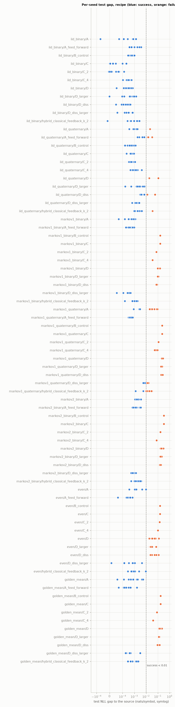

# Phase 3b: quantum ablations of architecture A

Issue #7, part of the campaign in issue #2 (§6). The question is *what* about
measurement-conditioned memory matters. Each variant below changes one thing
about architecture A and keeps everything else the same: the trainer, splits,
metrics, recipe and seeds of Phase 2 (`docs/phase2-results.md`). All of them
share A's interface (`log_prob`, `step_log_probs`, `predictive_probs`, `sample`,
`n_parameters`), and they live in `src/qmem/ablations.py`. The tests are in
`tests/test_ablations.py`.

Reproduce every number here with one command (about an hour (about 420 CPU-minutes for 770 runs) with 7 workers):

```sh
uv run python experiments/phase3b.py --config experiments/configs/phase3b.toml
```

The generated tables are in [`results/summaries/phase3b/summary.md`](../results/summaries/phase3b/summary.md),
with `main.csv`, `summary.json` and `gaps.png`. The raw per-run records go to
`results/phase3b/<timestamp>/` (gitignored). If a run is interrupted,
`--from-run <dir>` trains only the missing runs.

## 1. The variants

Notation as in `docs/architecture.md`. `U` is the per-step circuit on memory `M`
and output ancillas `A` (no env ancillas in the recipe). The instrument of `U` is
`Phi_y(rho) = sum_e K_{y,e} rho K_{y,e}^†` with effects `M_y`. `rho_0 = |00><00|`.

| variant | prediction for `y_t` | memory after `y_t` | in `qmem.ablations` |
|---|---|---|---|
| **A**, conditioned | `Tr(M_y rho_{t-1})` | `Phi_{y_t}(rho_{t-1}) / p(y_t)` | `build_model` (unchanged) |
| **B**, outcome-averaged *control* | `Tr(M_y rho_{t-1})` | `E(rho_{t-1}) = sum_y Phi_y(rho_{t-1})` | `OutcomeAveragedModel` |
| **C_k**, reset | `Tr(M_y rho_{t-1})` | A's update, then `rho_0` if `t` is a multiple of `k` | `ResetMemoryModel` |
| **D**, separate update / readout | `Tr(M^R_y rho_{t-1})` | `V_{y_t} rho_{t-1} V_{y_t}^†` (unitary) | `SeparateUpdateReadoutModel` |
| **D_diss**, D with a dissipative update | `Tr(M^R_y rho_{t-1})` | `Tr_env[U_{y_t} (rho_{t-1} ⊗ \|0><0\|) U_{y_t}^†]` | `SeparateUpdateReadoutModel(update_env=1)` |
| **A (feed-forward)**, A in the #9 layout | `Tr(M_y rho_{t-1})` | `W_{y_t} D_{y_t}(g) V rho V^† D^† W^† / p` | `build_model` with `feedforward_depth = 2` |
| **hybrid**, classical feedback | `Tr(M_y(h_t) rho_{t-1})` | `Phi_{y_t}^{(h_t)}(rho_{t-1}) / p(y_t)` | `ClassicalFeedbackModel` |

All variants are built by `qmem.ablations.build_variant` from the `[model]` table
plus a `variant` key and the variant's own settings (`reset_every`,
`update_depth`, `feedback_lags`). A, B, C_k and the hybrid start from identical
circuit parameters for a given seed.

### A: measurement-conditioned memory

This is the Phase 2 model and recipe, unchanged: 2 memory qubits, `memory_depth = 2`
memory-only hardware-efficient layers `V`, controlled-RY(2g) coupling `C(g)` with
trainable `g`, then `joint_depth = 2` layers `J` on memory plus output.
`U = J C(g) V`. Prediction and memory update are the same quantum operation.

### B: outcome-averaged control (not a competitor)

B uses the same instrument, but the memory follows the unconditioned channel
whatever token is observed, so

```
p_B(y_t | y_<t) = Tr(M_y E^{t-1}(rho_0)),
```

which does not depend on `y_<t`. **B ignores the observed history by
construction.** On a stationary source the best it can do is the best i.i.d.
model, and A ≥ B (in likelihood) is guaranteed. Following the literature review
(§3, item 4), B is reported only as a control, to check that the
conditioning is what A exploits.

*Identity tested* (`test_b_equals_marginal_of_a_over_all_histories`): at the same
parameters, B's distribution for `y_t` is A's marginal of `y_t` summed over every
history `y_<t`, and B's memory is A's `E^t(rho_0)`. This follows from
`sum_y Phi_y = E` and linearity:
`sum_{y_<t} Phi_{y_{t-1}} ... Phi_{y_1}(rho_0) = E^{t-1}(rho_0)`.

Two B numbers are reported. One is **B trained as B**. The other is **A's
outcome-averaged prediction**: each trained A, evaluated with its memory replaced
by `E^{t-1}(rho_0)`. The second is B at A's parameters (the Phase 2 preview,
now for every seed). It also gives the conditioned versus unconditioned
state-dynamics diagnostics of brief §9.

### C and C_k: reset memory

After the k-th, 2k-th, … token the memory is reset to `rho_0`. Within a block of
`k` tokens the update is A's. C = C_1 is memoryless: every prediction comes from
`rho_0`, so C is an i.i.d. model. C_2 and C_4 are finite-window retention probes.

- **Bound.** With resets every `k` tokens, `p(y_1..y_T)` factorises over blocks
  (tested: `test_c1_is_memoryless_and_ck_factorises_into_blocks`). The best C_k is
  therefore the source's own predictor restarted every `k` tokens. Its
  expectation is `H(Y_1..Y_k)/k` (`task.optimal_nll(k)`), because every source
  starts stationary. The summary reports each C_k against this bound on the same
  test sequences (paired), and against the oracle.
- **Reset state.** The reset state is fixed at `rho_0 = |00>`, not trained. The
  memory-only layers `V` act before every readout, so a trainable reset state would
  only re-parameterise `V rho_0` and would add no expressiveness for C_1.
- **On hardware**, a reset of the 2 memory qubits every `k` tokens.

### D: separate update and readout (the key comparison)

```
p_D(y_t | y_<t) = Tr(M^R_y rho_{t-1}),        rho_t = V_{y_t} rho_{t-1} V_{y_t}^†
```

- **Readout.** `M^R_y` are the effects of a readout instrument with A's layout
  (coupling `C(g)` and joint layers `J`, built by `build_model`). Its
  post-measurement state is **discarded**: the readout contributes only
  `p(y|rho)`, the Born rule with a separate effect.
- **Update.** `V_y` is a token-controlled unitary on the memory qubits only: one
  hardware-efficient layer per token value (RY, RZ on each memory qubit, then a
  CNOT), with its own parameters. This is an input-driven quantum RNN, in the
  template of the literature review §2.4.
- **Pure memory.** From `rho_0 = |00>` the memory stays pure and is a
  deterministic function of the token history,
  `|psi_t> = V_{y_t} ... V_{y_1} |00>` (tested).

**Parameter matching.** D uses no memory-only layers in its readout, because the
`V_y` already precede every readout:

| alphabet | A | D |
|---|---|---|
| binary | `V` 8 + `g` 1 + `J`(depth 2, 3 qubits) 12 = **21** | `g` 1 + `J`(depth 2) 12 + 2 × `V_y` 4 = **21** |
| 4 symbols | `V` 8 + `g` 2 + `J`(depth 2, 4 qubits) 16 = **26** | `g` 2 + `J`(depth 1) 8 + 4 × `V_y` 4 = **26** |

- **Matched:** memory dimension (2 qubits), number of trainable parameters,
  trainer, recipe, training budget (1500 steps maximum, the same early stopping),
  data and seeds.
- **Not matched:**
  - for 4 symbols, D's readout is shallower (one joint layer, not two) to keep
    the parameter count equal;
  - D's update is a unitary while A's is a general (non-unitary, normalised)
    Kraus map;
  - circuit depth and two-qubit gate counts differ (table in §2).
- **D+ check.** A second D, labelled **D+**, uses A's whole circuit as the readout
  and two-layer `V_y` (37 and 58 parameters). If D loses to A, D+ tells us whether
  it was only short of parameters.

**What D is physically.** The issue suggested D is "measure-then-feedforward, with
a classical control bit only one step long". That holds only with a caveat, and
it changes how D's resources should be read:

- **The cost of the readout.** Measuring `M^R_y` on a single copy of the memory
  disturbs it. Some Kraus operators `L_y` with `L_y^† L_y = M^R_y` act, and
  "discarding the post-measurement state" leaves no memory to update. A
  sequential single-copy device that measures and then feeds forward `V_y`
  implements `rho -> V_y L_y rho L_y^† V_y^† / p(y)`. That is itself an
  instrument, a special case of A's model class (Kraus operators `V_y L_y`), not D.
- **D proper needs a readout that leaves the memory untouched.** Because `rho_t`
  is a known, deterministic function of the tokens, this is possible by
  **re-preparation**: to predict `y_t`, prepare `|00>`, apply the classically
  controlled `V_{y_1} ... V_{y_{t-1}}`, and measure the readout.
  - Generating or scoring a length-`T` sequence then takes `T` circuits with
    `T(T-1)/2` controlled unitaries in total.
  - The controller must store the **entire token history** classically. The
    one-step control bit is an illusion: the classical side holds all the
    information the memory holds.
  - Estimating `p(y|rho)` for teacher forcing costs shots per step, as for A.
- **D is not a "classical hidden state" model in the code.** The state that
  carries information between steps is the quantum memory, and nothing classical
  is fed to the readout. But D's memory is a pure state fixed by the history, so
  as a model class D is a complex linear RNN with unitary transitions and a Born
  readout. A has a Kraus update with normalisation, which is nonlinear in the
  state.

In short, A versus D compares two **model classes** at matched memory dimension
and parameter count. It does not compare two equally cheap devices: D's
physically faithful implementation costs `O(T^2)` gates and `O(T)` classical
memory per sequence.

### D_diss: D with a dissipative update (added after the first run)

The first full run showed unitary D failing on every task with memory (§3). A
unitary update is reversible: distinct memories stay distinct, so D can never
*forget* an old symbol. An order-1 Markov source needs exactly that. A's update
is a non-unitary Kraus map, so the measurement backaction can erase. To separate
"update and readout are separate" from "the update is reversible", D_diss
replaces `V_y` with a token-controlled **channel**: `U_y` acts on the memory
plus one fresh ancilla in `|0>`, which is then traced out (`update_env = 1`).
A hand-built `U_y` that swaps the old value into the ancilla and writes `y`
erases exactly (tested: `test_dissipative_d_update_can_erase`).

- **D_diss** (about matched): D's readout, and one hardware-efficient layer on 3
  qubits per token. That is 25 parameters for binary tasks (A: 21) and 34 for
  4 symbols (A: 26).
- **D_diss+** (larger): A's whole circuit as the readout, and two layers per
  token. That is 45 and 74 parameters, 2.1× and 2.8× A.

### A under the feed-forward layout (#9)

Issue #9 landed during this work, adding the layout `K_y = W_y D_y(g) V`
(`docs/phase3d-strength.md`). As the coordinator asked, A is also reported in
that layout: `joint_depth = 0`, `feedforward_depth = 2` and one shared `g`.
That is 25 parameters for binary tasks and 41 for 4 symbols. It is still
architecture A: one instrument whose backaction is the memory update.
`W_y` is applied after the readout, controlled by the outcome just measured.
The comparisons below use the Phase 2 recipe (`joint_depth = 2`) as *the* A.

### Hybrid classical-feedback control (reported separately)

After Stefanski et al. (literature review §2.1.4), the hybrid is A plus a
classical controller.

- **The controller.** Before the output ancillas are measured, ancilla `q` gets
  `RY(a_q) RZ(b_q)`, a trainable measurement basis, with
  `(a, b) = W h_t + c`. `h_t` holds the bits of the last `k = 2` tokens as ±1,
  most recent first, and 0 before the sequence starts.
- **Equivalently**, `K_y(h) = sum_{y'} R(h)_{y y'} K_{y'}`.
- **Starting point.** `W` and `c` start at 0, so the hybrid starts as A
  (tested). It has 6 extra parameters for binary tasks (27 in total) and 20 for
  4-symbol tasks (46).
- **What it measures.** The buffer `h_t` is a classical hidden state, so the
  hybrid shows how much a classical side memory adds. **It is never evidence for
  backaction.**

## 2. Circuits and resources per token

From `qmem.ablations.resource_counts`.

- **Depth** is an as-soon-as-possible schedule with every gate one time step.
- **Two-qubit gates:** a controlled-RY counts as one (it compiles to 2 CNOTs and 2 RY).
- **Every variant** uses 2 memory qubits plus `log2 |Y|` output ancillas. Each
  token needs one mid-circuit measurement per output ancilla, and that ancilla
  is reset.

| variant | symbols | qubits | parameters | depth | 1q gates | 2q gates | mid-circuit measurements | memory resets | classically controlled gates |
|---|---|---|---|---|---|---|---|---|---|
| A | 2 | 3 | 21 | 15 | 20 | 7 | 1 | 0 | 0 |
| A (feed-forward) | 2 | 3 | 25 | 13 | 16 | 5 | 1 | 0 | 10 |
| B (control) | 2 | 3 | 21 | 15 | 20 | 7 | 1 | 0 | 0 |
| C | 2 | 3 | 21 | 15 | 20 | 7 | 1 | 2 | 0 |
| C_2 | 2 | 3 | 21 | 15 | 20 | 7 | 1 | 1 | 0 |
| C_4 | 2 | 3 | 21 | 15 | 20 | 7 | 1 | 0.5 | 0 |
| D | 2 | 3 | 21 | 12 | 16 | 6 | 1 | 0 | 5 |
| D+ (larger) | 2 | 3 | 37 | 21 | 28 | 9 | 1 | 0 | 10 |
| D_diss | 2 | 3 | 25 | 13 | 18 | 7 | 1 | 0 | 8 |
| D_diss+ (larger) | 2 | 3 | 45 | 23 | 32 | 11 | 1 | 0 | 16 |
| hybrid (classical feedback, k=2) | 2 | 3 | 27 | 17 | 22 | 7 | 1 | 0 | 2 |
| A | 4 | 4 | 26 | 16 | 24 | 10 | 2 | 0 | 0 |
| A (feed-forward) | 4 | 4 | 41 | 13 | 16 | 6 | 2 | 0 | 10 |
| B (control) | 4 | 4 | 26 | 16 | 24 | 10 | 2 | 0 | 0 |
| C | 4 | 4 | 26 | 16 | 24 | 10 | 2 | 2 | 0 |
| C_2 | 4 | 4 | 26 | 16 | 24 | 10 | 2 | 1 | 0 |
| C_4 | 4 | 4 | 26 | 16 | 24 | 10 | 2 | 0.5 | 0 |
| D | 4 | 4 | 26 | 9 | 12 | 6 | 2 | 0 | 5 |
| D+ (larger) | 4 | 4 | 58 | 22 | 32 | 12 | 2 | 0 | 10 |
| D_diss | 4 | 4 | 34 | 10 | 14 | 7 | 2 | 0 | 8 |
| D_diss+ (larger) | 4 | 4 | 74 | 24 | 36 | 14 | 2 | 0 | 16 |
| hybrid (classical feedback, k=2) | 4 | 4 | 46 | 18 | 28 | 10 | 2 | 0 | 4 |

Notes:

- **B** has A's circuit. On hardware it would be A with the memory decohered by
  averaging over outcomes. Its teacher-forced likelihood does not depend on
  the data's history.
- **C_k** adds a reset of both memory qubits every `k` tokens.
- **D:**
  - the depth is readout plus one `V_y`, and the `V_y` gates are classically
    controlled by the last token;
  - this is the *per-step* cost only. The re-preparation that makes D faithful
    multiplies the update cost by `t` at step `t` (§1).
- **Hybrid:** two classically controlled single-qubit rotations per output
  ancilla, and a classical buffer of `k · log2 |Y|` bits.

## 3. Results

All runs use the Phase 2 data (`data.seed = 0`, 512/256/512 sequences of length 32),
recipe and trainer, with 10 model seeds per (task, variant), 770 runs in total.
None crashed or diverged. Every run early-stopped except 19, which used all 1500
steps. Full tables, with mean ± SE, bootstrap CIs, lag profiles and the
generation check, are in [`summary.md`](../results/summaries/phase3b/summary.md).



### 3.1 The A/B/C/D table

Each cell is the median test gap to the oracle in nats/symbol, with failed runs
out of 10 in brackets (a run fails if its gap is ≥ 0.01). "FF" is A in the
feed-forward layout.

| task | A | A (FF) | B | C | C_2 | C_4 | D | D+ | D_diss | D_diss+ | hybrid |
|---|---|---|---|---|---|---|---|---|---|---|---|
| iid_binary | 0.0003 (0) | 0.0006 (0) | 0.0004 (0) | 0.0000 (0) | 0.0000 (0) | 0.0003 (0) | 0.0003 (0) | 0.0005 (0) | 0.0002 (0) | 0.0003 (0) | 0.0009 (0) |
| iid_quaternary | 0.0013 (1) | 0.0062 (3) | 0.0004 (0) | 0.0006 (0) | 0.0006 (0) | 0.0012 (0) | 0.1107 (10) | 0.0020 (0) | 0.0068 (4) | 0.0014 (0) | 0.0019 (1) |
| markov1_binary | 0.0006 (0) | 0.0004 (0) | 0.1606 (10) | 0.1606 (10) | 0.0764 (10) | 0.0357 (10) | 0.0988 (10) | 0.0963 (10) | 0.0800 (10) | 0.0003 (0) | 0.0012 (0) |
| markov1_quaternary | 0.0199 (7) | 0.0004 (0) | 0.2330 (10) | 0.2327 (10) | 0.1144 (10) | 0.0823 (10) | 0.2734 (10) | 0.2023 (10) | 0.1927 (10) | 0.0077 (3) | 0.0126 (8) |
| markov2_binary | 0.0016 (0) | 0.0016 (0) | 0.3281 (10) | 0.3276 (10) | 0.1666 (10) | 0.0767 (10) | 0.2065 (10) | 0.1721 (10) | 0.1631 (10) | 0.0007 (0) | 0.0019 (0) |
| even | 0.0011 (0) | 0.0003 (0) | 0.1562 (10) | 0.1561 (10) | 0.1431 (10) | 0.1027 (10) | 0.0345 (10) | 0.0290 (10) | 0.0490 (10) | 0.0007 (0) | 0.0006 (0) |
| golden_mean | 0.0007 (0) | 0.0002 (0) | 0.1710 (10) | 0.1710 (10) | 0.0827 (10) | 0.0380 (10) | 0.1407 (10) | 0.1234 (10) | 0.0885 (10) | 0.0004 (0) | 0.0005 (0) |

**Sanity results (as expected).**

- **All variants tie on i.i.d. data**, apart from unitary D on 4 symbols (gap 0.11),
  and D_diss and A (FF) on 4 symbols (median gaps 0.007 and 0.006).
- **B and C reach exactly the i.i.d. bound on every task.** Their mean test NLL is
  within 0.001 of the source-restarted-every-token NLL: 0.5614 against 0.5613 on
  order-1 Markov, 0.6410 against 0.6407 on Even. Their intervention effects are
  0 at every lag.
- **C_k reaches its own bound.** C_2 and C_4 are within 0.002 nats of the source
  restarted every k tokens on every task, except C_4 on `markov1_quaternary`
  (0.028, the same optimisation difficulty as A). Retention grows with k as it
  should: the Even process gives 0.156 / 0.143 / 0.103 for k = 1 / 2 / 4, against
  A's 0.001.
- **B at A's parameters.** Every trained A, made to predict from its
  outcome-averaged memory `E^{t-1}(rho_0)`, falls to the i.i.d. bound. For
  example, order-1 Markov gives 0.5615 ± 0.0001 against the bound 0.5613, and
  Even gives 0.6412 against 0.6407. All of A's benefit comes from the conditioned
  update. The averaged state stays far from the conditioned one (mean trace
  distance 0.31–0.68), and the conditioned memory is always pure, while
  `E^t(rho_0)` has purity 0.33–0.78 (`summary.md`).
- **Generation.** Sampled 3-gram statistics of A, A (FF), D_diss+ and the hybrid
  are within 0.01 of the noise floor. B and C reproduce the i.i.d. marginal only.

### 3.2 A versus D: the key comparison

Mean test gap, D minus A, in nats/symbol (unpaired over seeds, 95% bootstrap CI).
Successful runs are given as A / D, out of 10.

| task | D (matched, unitary) | D_diss (≈ matched, dissipative) | D_diss+ (2–3× parameters, dissipative) |
|---|---|---|---|
| iid_binary | −0.0002 [−0.0006, 0.0001]; 10/10 | −0.0003 [−0.0007, 0.0000]; 10/10 | −0.0001 [−0.0004, 0.0003]; 10/10 |
| iid_quaternary | +0.099 [0.079, 0.110]; 9/0 | +0.018 [0.004, 0.035]; 9/6 | −0.0015 [−0.0057, 0.0009]; 9/10 |
| markov1_binary | +0.108 [0.099, 0.119]; 10/0 | +0.079 [0.075, 0.084]; 10/0 | −0.0004 [−0.0006, −0.0001]; 10/10 |
| markov1_quaternary | +0.231 [0.201, 0.258]; 3/0 | +0.182 [0.154, 0.208]; 3/0 | −0.025 [−0.047, −0.007]; 3/7 |
| markov2_binary | +0.211 [0.189, 0.238]; 10/0 | +0.162 [0.150, 0.173]; 10/0 | −0.0010 [−0.0015, −0.0006]; 10/10 |
| even | +0.047 [0.032, 0.066]; 10/0 | +0.051 [0.036, 0.069]; 10/0 | −0.0014 [−0.0035, 0.0002]; 10/10 |
| golden_mean | +0.152 [0.137, 0.172]; 10/0 | +0.100 [0.088, 0.115]; 10/0 | −0.0007 [−0.0021, 0.0006]; 10/10 |

- **At matched size, D loses on every task with memory.** All 100 D and D_diss runs on
  the five tasks with memory failed.
  This holds for the exactly matched unitary D (21 and 26 parameters) and the
  dissipative D_diss (25 and 34). Doubling the unitary D (D+, 37 and 58
  parameters) does not help.
- **Unitary D cannot forget.** Its lag profiles stay flat where the source's
  drop to zero. On order-1 Markov a symbol 8 steps back moves its prediction by
  0.15 in TV, against 0 for the source. On i.i.d. data it moves it by 0.02–0.05.
- **A larger dissipative D matches A.** D_diss+ (45 and 74 parameters) ties
  A on every task and is slightly better on the hard 4-symbol Markov task (7/10
  successes against A's 3/10, gap −0.025). Its lag profiles match the source's
  (order-2 Markov: 0.586 / 0.176 / 0.008 against the source's
  0.586 / 0.189 / 0.000).
- **A in the feed-forward layout** is the best model on the hard task: 10/10
  successes on `markov1_quaternary`, median gap 0.0004, with 41 parameters. It is
  slightly worse than the recipe on 4-symbol i.i.d. data (3 of 10 failed).

**How well matched were A and D?** Memory dimension (2 qubits), data, seeds,
trainer, recipe and budget were identical. Parameter counts were identical for
D, within +4/+8 for D_diss, and 2.1–2.8× A for D_diss+. Not matched:

- the form of the update (unitary or a 3-qubit channel, against A's Kraus map);
- the readout depth (D's 4-symbol readout has one joint layer, not two);
- the gate counts (table in §2);
- the physical cost (D needs re-preparation, §1).

### 3.3 Hybrid classical-feedback control

The hybrid (A plus a classical controller fed by the last 2 outcomes) ties A on
every task. It is slightly better on `markov1_quaternary` (median gap 0.013
against 0.020; 2 against 3 successes) and slightly worse on i.i.d. data. Two
symbols of classical side memory add almost nothing on these tasks, because A
already reaches the optimum where it trains. This is a hybrid baseline, **not
evidence for backaction.**

### 3.4 Record provenance

- **Commits.** The 770 records come from four commits. 560 were trained before the
  branch was rebased onto #8 and #9 (`44d7c21`, `7aa2fbd`); 25 of those carry
  `git_dirty = true` because only docs were uncommitted while they started. The
  first 57 D_diss runs were trained at `e57872a`. The rest were trained after the
  rebase (`1d442a3`). These are pre-rebase or branch SHAs. The model code that
  trained each record is the same, apart from the additions (`update_env`,
  feed-forward support), which do not change existing variants.
- **Interruption.** The second batch was interrupted once and resumed with
  `--from-run`.


## 4. What this shows, and what it does not

**Shown (in simulation, on the Phase 2 tasks, 2 memory qubits, 10 seeds):**

1. **Conditioning is what A uses.** B (outcome-averaged) and C (reset) reach the
   i.i.d. bound and no further. A at its own trained parameters, with its memory
   averaged over outcomes, falls to that same bound. C_k recovers exactly the
   block-restricted optimum, and its retention grows with k.
2. **At matched memory dimension and parameter count, the conditioned instrument
   (A) beats a separately parameterised readout and update (D).** This holds on
   every task with memory, by 0.05–0.27 nats/symbol, for both a unitary and a
   one-layer dissipative update.
3. **The gap closes with a large enough dissipative update.** D_diss+ uses 2–3×
   A's parameters and a non-unitary token-controlled channel, and matches A.
   "Update = readout" is therefore *not necessary* to model these sources. What A
   gets from it is **parameter efficiency**: one operation gives both the
   prediction and a dissipative, outcome-conditioned memory update. D has to buy
   the same erasure with separate, larger update circuits.
4. **A unitary (reversible) memory update cannot represent finite-order
   sources** at this size, because it cannot forget. Memory dissipation is
   necessary. In A, measurement backaction provides it.

**Not shown, and not claimed:**

- **Any quantum advantage.** D_diss+ is as good as A, and classical baselines
  are issue #6.
- **That D_diss at exactly A's parameter count is impossible.** Its one-layer
  update may only be hard to train, or poorly parameterised for erasure. A
  better-designed update of the same size might close the gap.
- **That A is cheaper on hardware.** A is cheaper than *faithful* D, which needs
  re-preparation (`O(T^2)` gates per sequence and the full history stored
  classically), but both need postselection for teacher forcing.
- **Anything about longer memories, larger registers or measurement strength.**
  Those are the sibling issues.

**Worth flagging:**

- **The issue's framing of D needed a correction.** "Measure, then feed forward
  with a one-step control bit" cannot implement D on a single copy. If done
  sequentially, it is itself an instrument and so a special case of A. See §1.
- **D_diss, D_diss+ and A (FF) were added after the first full run.** D_diss
  responds to the reversibility finding; A (FF) follows the coordinator's
  request once #9 landed. They were not pre-registered, and every run is
  reported.

