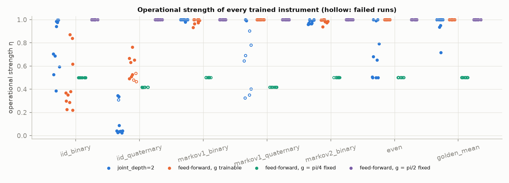
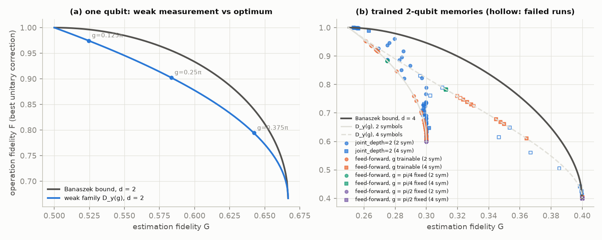

# Phase 3d: a measurement strength that means something

Issue #9 (campaign #2, open question 1 of the literature review). It builds on
Phase 2 (`docs/phase2-results.md`). The maths is in `docs/architecture.md`
sections 2.1–2.3; the generated tables are in `results/summaries/phase3d/summary.md`.

Reproduce (about 23 min with 7 workers):

```
uv run python experiments/phase3d.py --config experiments/configs/phase3d.toml
```

## What was built

* **Feed-forward layout** (`feedforward_depth > 0`, `joint_depth = 0`):
  `K_y = W_y · D_y(g) · V`, with a trainable memory unitary `W_y` for each
  outcome (`OutcomeConditionedBlock`). The effects `E_y = V^† D_y^† D_y V` don't
  depend on `W`, so `g` and `V` fix everything one readout can reveal, and `W_y`
  only steers the post-measurement memory. The proof, the `g = 0` and
  `g = pi/2` limits and the hardware forms (mid-circuit measurement plus a
  classically controlled `W_y`, or the same gates controlled by the ancilla before
  its readout) are in architecture section 2.1. All of them are tested
  (`tests/test_strength.py`). Defaults are unchanged.
* **Global strength:** `strength_shared = true` gives one `g` for every output
  coupling. Architecture section 2.2 gives the reasoning.
* **Operational metrics** (`qmem.metrics`) for any `Instrument`. The main ones:
  * Operational strength `eta`: Banaszek's estimation fidelity rescaled to [0, 1].
  * Worst-case TV gain.
  * `I(R:Y)` at the stationary memory state.
  * Disturbance `1 − F`: Banaszek's operation fidelity after the best unitary
    correction for each outcome.
  * The Banaszek bound.
  * A task-imposed floor on `eta`.

  Closed forms for the weak family `D_y(g)` are tested (e.g. `eta = sin^2 g`,
  `F = (2 + cos g)/3` on a qubit), as are Monte Carlo and random-instrument checks.

## Metric definitions (summary)

`d` is the memory dimension, `Y` the number of outcomes, `E_y` the effects. Gains
depend on the effects only, so they are blind to anything applied after the readout.

| metric | definition | no information | maximal |
| --- | --- | --- | --- |
| `eta` (operational strength) | `(sum_y lambda_max(E_y) − 1)/(min(Y,d) − 1)` | 0 | 1 |
| TV gain | `max_{rho,sigma} TV(p(.|rho), p(.|sigma))` | 0 | 1 |
| `G` (Banaszek 2001) | `(d + sum_y lambda_max(E_y))/(d(d+1))` | `1/d` | `2/(d+1)` |
| `I(R:Y)` (Buscemi, Hayashi and Horodecki 2008) | `S(rho) − sum_y p_y S(sqrt(rho) E_y sqrt(rho)/p_y)` at the stationary `rho` | 0 | `ln min(Y,d)` |
| `F` (Banaszek 2001) | `(d F_e + 1)/(d+1)`, `F_e = max_{U_y} sum |Tr(U_y^† K_{y,e})|^2/d^2` | 1 | — |
| disturbance | `1 − F` (correction-invariant: feed-forward is free) | 0 | — |
| `eta` floor of a task | `(sum_y max_h p(y|h) − 1)/(min(Y,d) − 1)` over the source's histories | — | — |

The floor follows from `p(y|rho) <= lambda_max(E_y)`: any model that reproduces
the source exactly has at least that much operational strength. It is computed
here from the oracle's next-symbol distributions on the test histories.

## Results (2 memory qubits, 10 seeds per cell, Phase 2 data and recipe)

### Does the feed-forward layout train as well as `joint_depth = 2`?

Gap to the source's own test NLL (nats/symbol), mean ± SE, with the number of
failed runs (gap ≥ 0.01) out of 10:

| task | `eta` floor | `joint_depth=2` (Phase 2 recipe, rerun) | FF, `g` trainable | FF, `g = pi/4` fixed | FF, `g = pi/2` fixed |
|---|---|---|---|---|---|
| iid binary | 0 | 0.0006 ± 0.0002, 0/10 | 0.0012 ± 0.0004, 0/10 | 0.0019 ± 0.0009, 0/10 | 0.0004 ± 0.0001, 0/10 |
| iid 4-symbol | 0 | 0.0032 ± 0.0020, 1/10 | 0.0096 ± 0.0029, **3/10** | 0.0155 ± 0.0039, **7/10** | 0.0006 ± 0.0001, 0/10 |
| Markov-1 binary | 0.60 | 0.0007 ± 0.0001, 0/10 | 0.0005 ± 0.0001, 0/10 | 0.0376 ± 0.0008, **10/10** | 0.0004 ± 0.0001, 0/10 |
| Markov-1 4-symbol | 0.37 | 0.0342 ± 0.0108, **7/10** | 0.0005 ± 0.0000, 0/10 | 0.1845 ± 0.0016, **10/10** | 0.0004 ± 0.0000, 0/10 |
| Markov-2 binary | 0.80 | 0.0018 ± 0.0002, 0/10 | 0.0021 ± 0.0003, 0/10 | 0.2064 ± 0.0006, **10/10** | 0.0014 ± 0.0004, 0/10 |
| Even | 0.50 | 0.0023 ± 0.0009, 0/10 | 0.0004 ± 0.0001, 0/10 | 0.2085 ± 0.0000, **10/10** | 0.0004 ± 0.0001, 0/10 |
| Golden mean | 0.50 | 0.0016 ± 0.0006, 0/10 | 0.0004 ± 0.0001, 0/10 | 0.2265 ± 0.0000, **10/10** | 0.0002 ± 0.0001, 0/10 |

* **Yes, and better.** With `g` trainable the feed-forward layout matches
  `joint_depth = 2` on every task with memory, and is better on 4-symbol Markov-1,
  Phase 2's open failure: 0/10 failed against 7/10. The only cell where it is worse is i.i.d. 4-symbol (3/10 failed, against
  1/10): the gaps are small (median 0.006) but sit above the 0.01 line more often.
* **With `g = pi/2` fixed** (projective readout of one memory qubit per
  output ancilla, plus feed-forward), every task trains, all 70 runs, with
  the smallest gaps of all.
* **With `g = pi/4` fixed, every task with memory fails, and the failures are
  structural.** In this layout `lambda_max(E_1) = sin^2 g` for a binary
  alphabet, so `p(1|rho) <= sin^2 g = 0.5` for *every* memory state. Each of these
  sources needs a larger probability somewhere: Markov-1 needs `p(1) = 0.7`,
  Markov-2 needs 0.9, and Even and Golden mean need 1. The constant gaps across
  seeds (SE ≈ 0) are the best fit under that cap. So this is a representability
  limit, not an optimisation one. For 4 symbols the corresponding caps are
  `p(00) >= cos^4 g`, `p(11) <= sin^4 g` and so on.

### What strength does training choose?

Operational strength `eta` of the trained instruments, mean ± SE [min, max] over
10 seeds, with the learned (nominal) `g`:

| task | `eta` floor | `joint_depth=2`: `eta` | `joint_depth=2`: nominal `g` | FF trainable: `eta` | FF trainable: `g` |
|---|---|---|---|---|---|
| iid binary | 0 | 0.78 ± 0.07 [0.39, 1.00] | 0.63 | 0.45 ± 0.08 [0.22, 0.87] | 0.73 |
| iid 4-symbol | 0 | 0.13 ± 0.04 [0.02, 0.35] | 1.03 | 0.57 ± 0.03 [0.46, 0.76] | 0.94 |
| Markov-1 binary | 0.60 | 1.00 ± 0.00 [0.98, 1.00] | 0.88 | 0.99 ± 0.01 [0.93, 1.00] | 1.48 |
| Markov-1 4-symbol | 0.37 | 0.71 ± 0.09 [0.32, 1.00] (successful runs: 1.00) | 1.03 | 1.00 ± 0.00 | 1.57 |
| Markov-2 binary | 0.80 | 0.98 ± 0.01 [0.96, 1.00] | 1.05 | 0.98 ± 0.01 [0.94, 1.00] | 1.48 |
| Even | 0.50 | 0.71 ± 0.07 [0.50, 1.00] | 1.28 | 1.00 ± 0.00 | 1.57 |
| Golden mean | 0.50 | 0.96 ± 0.03 [0.72, 1.00] | 1.01 | 1.00 ± 0.00 | 1.57 |



* **With `joint_depth = 2`, nominal `g` says nothing about the strength.**
  Example seeds: iid binary seed 1 learns `g = 0.05` and has `eta = 0.997`; Even
  seed 4 learns `g = 1.57` and has `eta = 0.50`. Use `eta`, not `g`, for any
  layout other than feed-forward.
* **First data point on open question 1.** When the readout is unconstrained
  (`joint_depth = 2`), training lands **between the task's floor and projective**.
  It does not prefer weak measurement:
  * On Markov-1 binary, Markov-2 and Golden mean it chooses (near-)projective
    readouts, `eta ≈ 1`.
  * On 4-symbol Markov-1 every *successful* run is projective (`eta = 1.00`), and
    every failed run is weaker (0.32–0.90).
  * On Even, 4 of 10 seeds sit exactly on the floor `eta = 0.50`. These are the
    weakest readouts that can reproduce the source, and they reach the same gaps
    (≈ 0.001) as the projective seeds. So weak instruments are reachable and work
    when the source allows them, but nothing in the likelihood rewards them over
    strong ones.
  * On i.i.d. sources information is useless. `eta` wanders from seed to seed,
    and `I(R:Y)` at the stationary state stays below 0.05 nats: the instrument can
    be sharp, but the memory sits where it reads nothing.
* **Feed-forward with trainable `g`** goes projective (`g → pi/2`) on every task
  with memory. On Even and Golden mean this is forced: `p(1|h) = 1` occurs, and
  the cap `sin^2 g >= 1` requires it. On Markov-1 and Markov-2 it needs only
  `g >= 0.99` and `g >= 1.25`, but training still goes to ≈ 1.5. On i.i.d. binary
  it stays weak (`eta` 0.22–0.87, just above the `p(1) = 0.2` cap of 0.2).

### Information–disturbance trade-off



* Panel (a): the weak family on a qubit against Banaszek's bound. The two touch only
  at `g = 0` and `g = pi/2`; in between, `D_y(g)` is suboptimal by up to 0.056 in `F`.
* Panel (b): every trained instrument lies on or below the `d = 4` bound, as it
  must. The feed-forward runs sit on the analytic `D_y(g)` curves (binary: solid;
  4 symbols: dashed). The `joint_depth = 2` runs scatter more widely: their
  instruments aren't of the `D_y` form.
* The *uncorrected* operation infidelity is ≈ 0.75 for every layout, which is
  Haar-random level. Every trained memory applies a large unitary each step;
  only the correction-invariant `F` is a meaningful disturbance measure here.
* The binary-outcome points can't reach `G = 2/(d+1) = 0.4`: with 2 outcomes on
  4 levels, the largest possible `G` is 0.3. The bound is for unrestricted outcome
  counts, so it isn't tight for binary readouts on `d = 4`.

## What this means for the Phase 3 sweeps

1. **Use the feed-forward layout with a shared `g` for strength sweeps.** It
   trains at least as well as `joint_depth = 2`, and its `g` is the
   operational strength (`eta = sin^2 g` for a binary alphabet).
2. **Report `eta` (and the floor) for every layout**, using
   `qmem.metrics.operational_summary(model.instrument())`. The HQMM baseline in
   #6 can use the same call.
3. **Read weak-`g` failures against the task floor.** A sweep below the floor
   (`sin^2 g < max_h p(1|h)` for binary) fails because the source can't be
   represented, whatever the memory does. Sources with deterministic
   transitions (Even, Golden mean, delayed recall, parity) need `lambda_max = 1`
   for some effect, i.e. a projective component. A fair test of "does weak
   measurement help" needs sources whose next-symbol probabilities are bounded
   away from 0 and 1, or a comparison at matched `eta` above the floor.
4. Further question: would a coupling with a biased ancilla start (effects not
   pinned at `lambda_max(E_0) = 1`) loosen the per-outcome cap while keeping
   `eta` fixed? The floor says the *sum* constraint can't be avoided.

## Shown vs speculative

* **Shown:**
  * Effect invariance under `W` (proof and tests).
  * The metric closed forms.
  * The training tables above (10 seeds each).
  * The fixed-`pi/4` failures are explained exactly by the probability cap
    (constant gaps; the floor table).
  * Unconstrained training lands anywhere between the floor and projective, and
    the successful 4-symbol Markov-1 models are all projective.
* **Not shown:** whether weak measurement helps on sources that need coherent
  memory, or on sources whose probabilities stay inside `(sin^2 g, cos^2 g)`.
  That is the next issue's sweep. The relation between `eta` and generalisation
  was not studied.

## Notes

* Phase 2 didn't keep its parameters in the repository (`results/` is
  gitignored, and the run directory was removed with its workspace), so the
  `joint_depth = 2` models were retrained with the same config. The results match
  Phase 2's table to the printed precision (e.g. 4-symbol Markov-1: 7/10 failed,
  gap 0.0342 ± 0.0108). Trained parameters are saved as `.pt` next to every run
  record (`results/phase3d/<timestamp>/runs/`).
* One of the 280 trained channels has a degenerate fixed point. Its `I(R:Y)` uses
  the minimum-norm fixed point.
* Citations used here and not yet in `docs/references.bib` (not verified at the
  source in this issue):
  * Buscemi, Hayashi and Horodecki, PRL 100, 210504 (2008), for `I(R:Y)` as the
    information gain.
  * Horodecki, Horodecki and Horodecki, PRA 60, 1888 (1999), and Nielsen,
    Phys. Lett. A 303, 249 (2002), for `F = (d F_e + 1)/(d + 1)`.

  Banaszek (2001) and Fuchs and Peres (1996) are in the bibliography.
