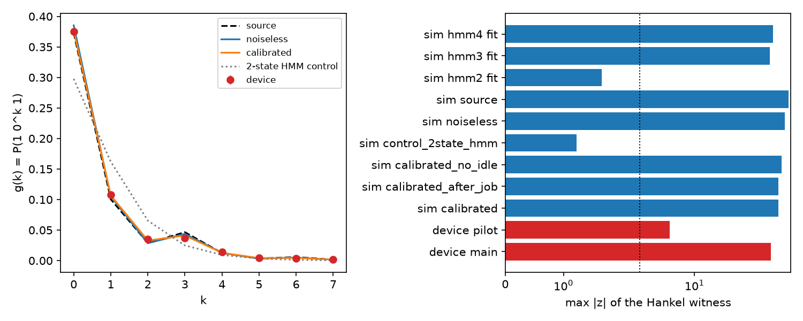

# Phase 6: the 1-qubit PMD N = 3 model on IBM hardware

Issue #16. This is the campaign's one run on a real quantum processor, at the owner's request,
on IBM's free Open plan. The trained 1-qubit instrument for PMD N = 3 (#11's validation-selected
`A/D2` run, re-trained bit for bit as in Phase 5a) ran as a generator on `ibm_kingston`
(Heron r2). It used two physical qubits, one persistent memory and one measured output, and
64 symbols per shot. There were two jobs: a 200-shot pilot and a 20,000-shot main run. The
device's output was then compared with the PMD source, the noiseless trained model, the
noisy model built from the device's own calibration, and classical HMMs fitted to the
device's shots.

Everything is in `results/summaries/phase6/`:
- **Raw data.** Every shot, bit-packed: `shots_pilot.npz` and `shots_main.npz`.
- **Job records.** `job_pilot.json` and `job_main.json`: job ids, timestamps, IBM usage and
  metrics, and the calibration snapshot after the job.
- **Circuits.** `circuit.qasm` (the transpiled 64-symbol circuit as submitted) and
  `step.qasm` (one step, used for the noise model).
- **Analysis.** `summary.json` (everything, including the calibration before the job),
  `witness.csv`, `blocks.csv`, `nll.csv`, `marginals.csv`, `witness.png`.
- **Log.** `log.txt`, the run's full log.

Reproduce (spends QPU time; needs the `hardware` group and `IBM_API_KEY`, `IBM_INSTANCE_CRN`
in `.env`):

```
uv run --group hardware python experiments/phase6.py --config experiments/configs/phase6.toml --dry-run
uv run --group hardware python experiments/phase6.py --config experiments/configs/phase6.toml
```

`--dry-run` runs every stage against a local Aer simulator of the live backend and submits
nothing. `--from-run <dir>` resumes a run: a submitted job is re-fetched by its saved id,
never resubmitted, and a saved analysis is reused.

## Verdict

- **The device produces a process that no 2-state classical model can produce exactly.**
  The Hankel witness is −0.00494 ± 0.00009 at offset 0, so |z| = 54. It is exactly zero for
  every 2-state HMM, and the 2-state HMM fitted to the device's own shots gives |z| ≤ 1.7.
  The other offsets give |z| = 33, 28 and 15. The 200-shot pilot alone gives |z| = 5.8.
- **The 1-qubit model predicts the device better than any classical HMM fitted to the
  device.** On 10,000 held-out shots, the noisy 1-qubit model built from the calibration,
  with no parameter fitted to the device data, has a lower negative log-likelihood (NLL)
  than every model below. Differences are in nats/symbol, paired over shots:

  | model | worse than the calibrated 1-qubit model by |
  |---|---|
  | 2-state HMM fitted by EM to 9,000 device shots | 0.0060 ± 0.0002 |
  | 3-state HMM fitted the same way | 0.0018 ± 0.0001 |
  | 4-state HMM fitted the same way | 0.0018 ± 0.0001 |
  | the PMD source itself | 0.0014 ± 0.0001 |
  | the noiseless trained model | 0.0013 ± 0.0000 |

- **The device is noisier than its calibration predicts.**
  - *The witness is smaller.* Its magnitude is 58–76% of the calibrated prediction, depending
    on the offset: |z| = 54 against 63 predicted for 20,000 shots, and w(1) = −0.018 against
    −0.032.
  - *Long blocks deviate beyond sampling.* For blocks of 8, D(device ‖ calibrated)/8 is
    0.00042 ± 0.00003 nats/symbol, against 0.00013 for data sampled from the calibrated
    model itself.
  - *The symbol rate drifts.* P(1) moves across the run: from 0.578 to 0.604 and back, by
    tenth of the shots (z = 8.3 between the halves).
- **Cost.** 16 s of QPU time (2 s pilot, 14 s main), against the 15.3 s estimated. That is
  2.7% of the free plan's 600 s per 28 days, and 584 s remain. On the Open plan it cost
  nothing; at Pay-As-You-Go list price (96 USD/min) it would be about 26 USD.

## 1. Setup

**Model.** It is `pmd_N3` from `experiments/configs/phase5a.toml`: lr 0.1, seed 8, 13
parameters. The re-trained model reproduces the committed validation NLL 0.6536773314117355
exactly (Δ = 0, `summary.json` → `reproduction`). PMD N = 3 is the case Phase 5a ranked
clearest (predicted |z| ≈ 68 at 20,000 shots).

**Circuit.**
- `qmem.hardware.export_circuit` builds 64 steps in the general layout. Each step is the
  trained memory and joint gates, a mid-circuit measurement of the output qubit into its own
  1-bit register `y<t>`, and a reset of the output before the next step. There is no
  classical feed-forward.
- It was transpiled against the live `ibm_kingston` target (`optimization_level = 3`,
  `seed_transpiler = 0`). The transpiler chose **physical qubit 75 as the memory and 59 as
  the output**, with the same layout at the end.
- Per symbol: 3 CZ and about 24 single-qubit gates (12 `sx`, 12 virtual `rz`). In all:
  192 CZ, 64 measurements, 63 resets and depth 1343.
- An ASAP schedule with the backend's durations gives 4.85 µs per step and 308 µs per shot.

**Calibration** at submission (`summary.json` → `prepare.calibration`), last updated
2026-11-07 22:05 UTC:

| qubit | role | T1 (µs) | T2 (µs) | readout error | sx error |
|---|---|---|---|---|---|
| 75 | memory | 321 | 138 | 1.51% | 1.0·10⁻⁴ |
| 59 | output | 250 | 371 | 0.39% | 1.8·10⁻⁴ |

The CZ between them has error 1.11·10⁻³ (calibrated 02:22 UTC) and lasts 68 ns. Measurement
takes 2.18 µs and reset 2.21 µs.

The snapshot taken after the main job (00:07 UTC, `job_main.json` → `calibration_after`)
carries a newer `last_update_date` (22:59 UTC). Every value for these two qubits and their CZ
is identical, so the "after" prediction equals the "before" one.

**Noise model for the predictions.** This is Phase 5a's exact noisy instrument, built from
the transpiled step on qubits 59 and 75:
- depolarising error after each gate at the reported error;
- a symmetric readout flip at the reported measurement error, and the same flip after a
  reset;
- T1/T2 relaxation of the idle qubit during measurement and reset.

`calibrated_no_idle` drops the relaxation.

**Execution.**
- SamplerV2 (qiskit-ibm-runtime 0.51.0) in job mode.
- No error mitigation: dynamical decoupling off, gate and measurement twirling off.
- Default `rep_delay` and `init_qubits`.
- Every shot starts from |00⟩.

SamplerV2 is deprecated in 0.51 in favour of a client-side sampler, but it is still
supported.

## 2. Jobs

| job | IBM id | shots | estimated | charged | circuit execution | queued | "running" |
|---|---|---|---|---|---|---|---|
| pilot | `dbnqundt7fqc73ak2b8g` | 200 | 2.1 s | 2 s | 0.11 s | 3.4 min | 25.1 min |
| main | `dbnrc4gqtr0c73adh8g0` | 20,000 | 13.2 s | 14 s | 11.3 s | 4.6 min | 25.8 min |

The charge matches Phase 5a's usage model (2 s per job plus `rep_delay` + circuit length
per shot) to within a second. Both jobs spent about 25 minutes in IBM's RUNNING state,
against 0.1 s and 11 s of circuit execution. That time is not billed. It is probably the
compilation and loading of a dynamic circuit with 64 mid-circuit measurements.

**Pilot gate.** Before the main job is submitted, the pilot must match the calibrated
prediction:
- the overall P(1): 0.5791 against 0.5819 (z ≈ −0.7);
- P(1) at each of the 64 positions: χ² = 80.4 on 64 degrees of freedom.

Both were within the thresholds set before the run (|z| < 6 and χ² < 132). The main run then
went ahead automatically.

**Before any QPU job,** the whole pipeline ran end to end on a local Aer model of
`ibm_kingston` (`--dry-run`), so no bug could spend QPU time:
- the first dry run, at 20,000 Aer shots, was stopped after 30 minutes inside Aer;
- the second capped Aer at 2,000 shots (`[dry_run] max_shots`) and passed.

Both are in `results/phase6_dryrun/` (gitignored).

## 3. The Hankel dimension witness

**Definition**, as in Phase 5a:
- g(k) = P(1 0ᵏ 1) at start positions ≥ 16, for k ≤ 7;
- w(j) = det[g(j+a+b)]₀≤a,b<3 / max|entry|³.

A 2-state HMM's g obeys an order-2 linear recurrence from any initial state, so every w(j)
is exactly 0. Standard errors come from 1,000 bootstrap resamples over shots.
`witness.csv`; for the "simulated" rows, 20,000 shots were sampled from each prediction.

| data | w(0) | z(0) | z(1) | z(2) | z(3) | max \|z\| |
|---|---|---|---|---|---|---|
| **device, main (20,000 shots)** | −0.00494 ± 0.00009 | −54.3 | −33.4 | −27.6 | −15.1 | **54.3** |
| device, pilot (200 shots) | −0.0070 ± 0.0012 | −5.8 | −3.5 | −2.9 | −1.3 | 5.8 |
| simulated: PMD source | −0.0109 | −80.0 | −47.2 | −54.4 | −27.5 | 80.0 |
| simulated: noiseless model | −0.0087 | −73.6 | −46.5 | −46.8 | −24.0 | 73.6 |
| simulated: calibrated model | −0.0068 | −63.5 | −39.7 | −36.3 | −18.9 | 63.5 |
| simulated: calibrated, no idle relaxation | −0.0078 | −68.4 | −43.0 | −42.0 | −21.7 | 68.4 |
| simulated: 2-state HMM fitted to the device | −0.00006 | −1.7 | 0.7 | −0.1 | 0.1 | 1.7 |
| simulated: random 2-state HMM (control) | 0.00004 | 0.7 | −0.1 | −1.2 | −0.9 | 1.2 |
| simulated: 3-state HMM fitted to the device | −0.0044 | −52.6 | −32.3 | −17.1 | −10.2 | 52.6 |
| simulated: 4-state HMM fitted to the device | −0.0044 | −56.8 | −34.4 | −18.0 | −10.7 | 56.8 |

**Exact w(j) for comparison:**

| | w(0) | w(1) | w(2) | w(3) |
|---|---|---|---|---|
| device (measured) | −0.0049 | −0.0184 | −0.0441 | −0.0043 |
| calibrated model | −0.0069 | −0.0317 | −0.0578 | −0.0060 |
| noiseless model | −0.0088 | −0.0492 | −0.0777 | −0.0089 |
| PMD source | −0.0108 | −0.0689 | −0.0860 | −0.0108 |
| any 2-state HMM | 0 | 0 | 0 | 0 |



**How to read it.**
- **The sign and shape are right.** g(k) on the device follows the PMD source's
  non-monotone shape, including the revival at k = 3 (period 3). A 2-state HMM cannot
  produce that revival: the order-2 recurrence fitted to g(0..2) misses g(3). That is what
  w(0) < 0 measures.
- **The 2-state null holds where it should.** Data simulated from the random 2-state
  control, and from the 2-state HMM fitted to the device, give |z| ≤ 1.7, as they must.
  The bootstrap errors are therefore calibrated, and |z| = 54 is far outside the null.
- **The amplitude falls short of the calibration.** It is 72% of the calibrated w(0) and
  58% of its w(1). Each layer of noise (calibrated, then device) moves the witness towards 0,
  the classical value, so the device is more dephased than its calibration says.
- **The 3- and 4-state HMMs fitted to the device** reproduce the device's witness
  (w(0) = −0.0045) about as well as anything here. Above 2 states, the witness alone does
  not separate the device from classical models.

## 4. Distributions and likelihoods

**Per-position P(1)** (`marginals.csv`). Over all symbols P(1) = 0.5809, against 0.5819
predicted by the calibrated model, 0.5866 by the noiseless model and 0.5738 by the source
(averages over the 64 positions, start transient included).
χ² of the 64 position frequencies against each prediction:

| prediction | χ² (64 dof) |
|---|---|
| calibrated | 79.7 |
| calibrated, no idle relaxation | 87.7 |
| noiseless | 237 |
| source | 360 |

The calibrated model explains the per-position rates almost to sampling level. Including
idle relaxation during measurement and reset improves the fit.

**Block KL**, D_L/L(device ‖ prediction), with blocks of length L aligned from position 16
(`blocks.csv`; bootstrap SE about 10% of each value). The null level is the same statistic on
20,000 shots sampled from the calibrated model:

| L | vs source | vs noiseless | vs calibrated | null (calibrated sampled vs calibrated) | vs 2-state HMM fit | vs 3-state HMM fit |
|---|---|---|---|---|---|---|
| 1 | 0.00011 | 0.00006 | 0.0000013 | 0.0000001 | 0.00006 | 0.00007 |
| 2 | 0.00025 | 0.00012 | 0.0000055 | 0.0000003 | 0.00013 | 0.00018 |
| 4 | 0.00064 | 0.00044 | 0.000085 | 0.0000065 | 0.00142 | 0.00040 |
| 8 | 0.00170 | 0.00126 | 0.00042 | 0.00013 | 0.00364 | 0.00073 |

At every block length, the calibrated 1-qubit model is the closest prediction to the device.
The fitted HMMs are farther, although they were fitted to these shots. The 2-state fit is
9–17× farther than the calibrated model at L ≥ 4. At L = 8 the device is still 0.0003
nats/symbol farther from the calibrated model than sampling explains. That is the extra
dephasing seen in the witness.

**Held-out NLL** (`summary.json` → `paired`). The HMMs were fitted by Baum-Welch EM:
- 8 random restarts per size;
- trained on the first 9,000 main-run shots, early-stopped on the next 1,000;
- all models scored on the last 10,000 shots;
- differences are paired over shots, so within-shot correlation is accounted for.

| model | fitted to device data | NLL (nats/symbol) | minus calibrated |
|---|---|---|---|
| **calibrated 1-qubit model** | no (13 trained + calibration) | **0.66146** | 0 |
| noiseless 1-qubit model | no | 0.66280 | +0.0013 ± 0.00005 |
| PMD source | no | 0.66289 | +0.0014 ± 0.00006 |
| 3-state HMM (17 free parameters) | yes | 0.66323 | +0.0018 ± 0.00007 |
| 4-state HMM (31) | yes | 0.66330 | +0.0018 ± 0.00007 |
| 2-state HMM (7) | yes | 0.66745 | +0.0060 ± 0.00016 |

**How to read it.**
- **2 states are not enough.** On the device's own data, the best 2-state HMM EM found is
  0.0060 nats/symbol worse than the 1-qubit prediction (37 SE). For scale, #11's gap between the
  best 2-state classical model and the source itself was 0.0137.
- **More classical states don't catch up.** 3- and 4-state HMMs close most of that gap but
  stay 0.0018 worse (26 SE), and 4 states are no better than 3. Possible causes:
  - EM is stuck in local optima (8 restarts);
  - the device's process genuinely needs more classical states, as PMD itself does;
  - the drift in section 5, which no stationary model captures.

  These data cannot separate the three, so this is **not** claimed as a lower bound on
  classical models.
- **The prediction beats the source and the noiseless model.** The calibrated model, built
  without seeing the data, is the best description of the device found here. Both the source
  and the noiseless model are worse than it, by about 0.0013–0.0014. The model of the noise
  is doing real work.

## 5. Drift

P(1) per tenth of the main run's 20,000 shots (`summary.json` → `paired.drift`):

| tenth | 1 | 2 | 3 | 4 | 5 | 6 | 7 | 8 | 9 | 10 |
|---|---|---|---|---|---|---|---|---|---|---|
| P(1) | 0.578 | 0.578 | 0.588 | 0.604 | 0.578 | 0.574 | 0.576 | 0.575 | 0.576 | 0.581 |

The first and second halves differ by 0.0087 ± 0.0011 (z = 8.3). Almost all of it is a
transient in tenths 3–4.

The shot order in the result is assumed to be time order; IBM does not document it.
- **What it suggests:** a short-lived change in the qubits during the 11 s of execution, for
  example a fluctuating two-level defect moving a T1 or a frequency.
- **What it costs:** a little in every statistic above. A stationary model cannot follow
  it, which is part of the excess block KL.
- **What it doesn't change:** the witness. Its bootstrap is over shots, so it is robust to
  slow drift, and 2,000 shots (one tenth) would still give |z| of about 54/√10 ≈ 17.

## 6. What this shows and what it does not

**It shows:**
- **A non-classical-in-dimension process.** A superconducting device, running a trained
  1-qubit instrument with one persistent memory qubit, produced a binary process that **no
  2-state classical HMM can produce exactly** (|z| = 54). This is Phase 5a's proposed test
  for N = 3, run.
- **Prediction without fitting.** Training in simulation plus a noise model from the
  public calibration predicted the device's process better than any classical HMM with up to
  4 states fitted to the device's own data.

**It does not show:**
- **That the device uses one qubit of memory.** Imperfect resets, leakage, the second
  qubit and spectators can all carry information between steps. The witness bounds the
  classical dimension of the *output process* from below. It says nothing about the device's
  physical memory.
- **Quantum advantage.** A 3-state classical HMM gives a process with the same witness, and
  the PMD source is itself a classical HMM. The finding is about dimension at fixed size:
  one qubit against two classical states. That is #11's simulation result, now seen on a
  device.
- **Generality.** One model (N = 3), one device, one qubit pair, one calibration window.
  N = 4–8 and the retention model of Phase 5a were not run, to stay within the free plan.

## 7. Provenance and caveats

- **Code.** The pipeline was at commit `df56639`. Its run directory (`config_meta.json`)
  records `git_dirty = true`, and the uncommitted change behind it could not be identified
  afterwards. After the run, `experiments/phase6.py` was changed only in how the summary is
  written: an absolute run-dir path, reuse of a saved analysis, and the paired-NLL and drift
  step. The jobs and the main analysis are unaffected. The summary's metadata records the
  commit it was written from.
- **Shot handling.** Shots are as returned: no readout correction and no post-selection.
- **Predictions.** "Simulated" rows use seed 5; the control HMM uses seed 21; the bootstrap
  uses seed 21 for the witness and seed 5 for the block KL (`experiments/configs/phase6.toml`).
- **Account usage.** The account's usage before and after each job is in the job JSONs:
  0 → 2 → 16 s.
