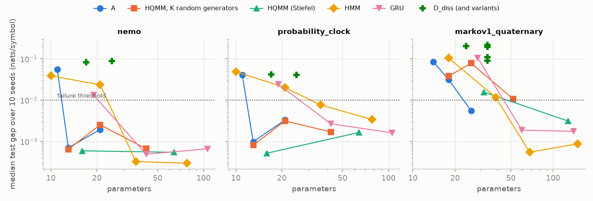
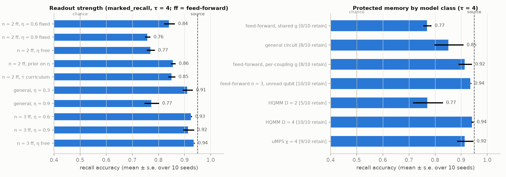
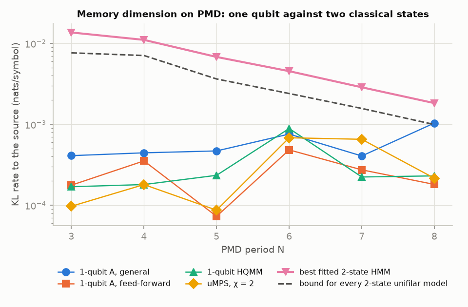
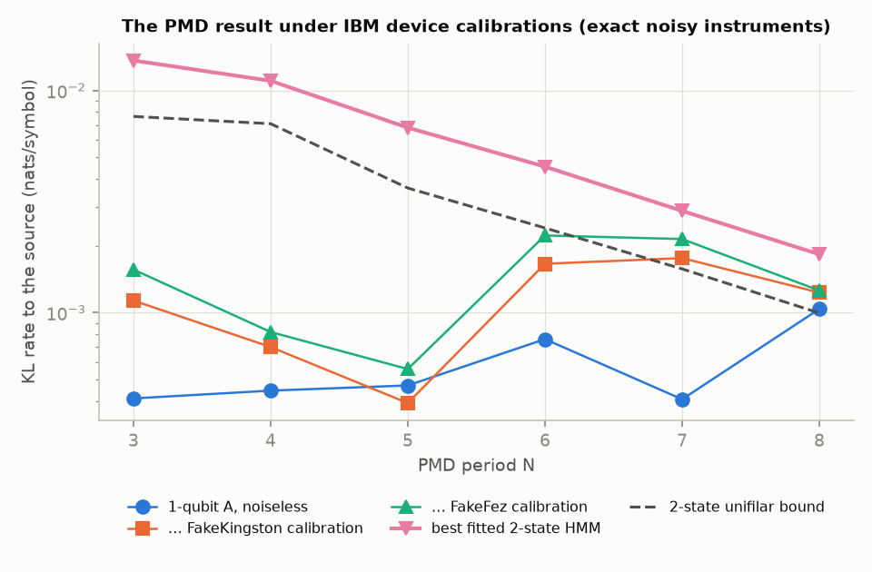
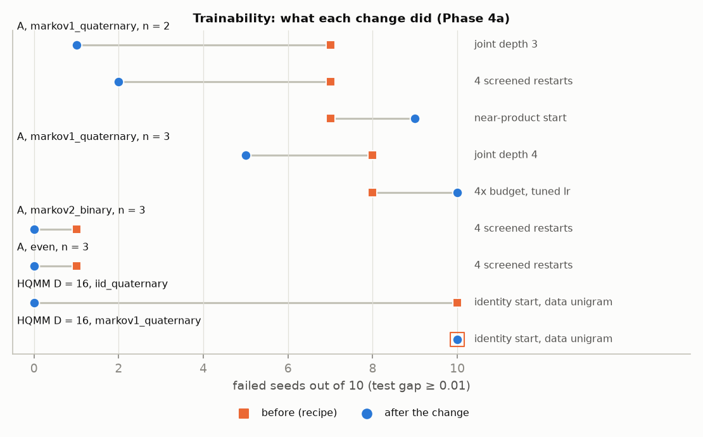
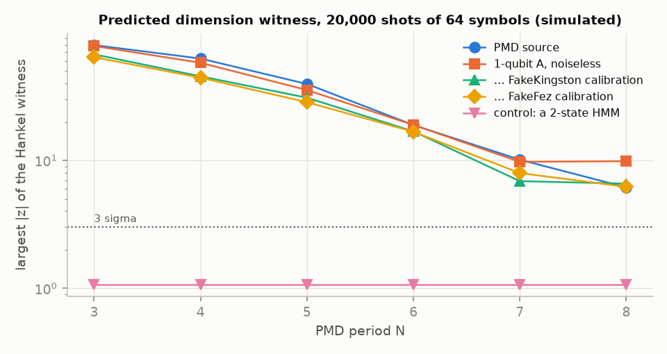

# Measurement-induced memory in quantum sequence models: campaign report

Issue #15 (deliverable 7 and section 15 of the campaign brief, #2). This report draws together
the phase notes on `main` and makes only the claims they support. Each section links to the
note that holds its evidence: [literature review](literature-review.md),
[architecture](architecture.md), [Phase 2](phase2-results.md),
[3a baselines](phase3a-baselines.md), [3b ablations](phase3b-ablations.md),
[3c benchmarks](benchmarks.md), [3d strength](phase3d-strength.md),
[3e retention](phase3e-retention.md), [3f grid](phase3f-grid.md),
[4a trainability](phase4a-trainability.md), [4b falsification](phase4b-falsification.md) and
[5a hardware](phase5a-hardware.md) and [6 hardware run](phase6-hardware-run.md). Everything
here is simulation, apart from a desk study of IBM hardware (#14) and one run on an IBM
device, PMD N = 3 on `ibm_kingston` (#16, section 6.1).

Figures are in `docs/figures/` and come from committed summaries only (section 5).

## 1. Summary

**The hypothesis** (#2, section 1). A trainable quantum instrument can produce the
next-symbol distribution and, in the same operation, leave its persistent memory in a useful
outcome-conditioned state. Optimising that disturbance for prediction might give different or
better memory than architectures that predict and update separately.

**What the evidence says.**

- **The mechanism works.** Architecture A is a parameterised circuit on memory qubits and
  fresh ancillas. Measuring the ancillas emits the symbol, and the memory keeps the
  conditioned state. It learns every Phase 2 source with exactly known optimum, although
  with the Phase 2 recipe only 3 of 10 seeds reach it on `markov1_quaternary`. Its
  dependence on the past matches each source's (the Even process still shows it 12 symbols
  back). All of the benefit comes from conditioning on the outcome. With the same parameters
  and the memory averaged over outcomes, every trained model falls to the i.i.d. bound.
- **The model class is not new.** One instrument per step, emitting a symbol and keeping the
  conditioned state, is a hidden quantum Markov model (HQMM) and a quantum causal simulator
  (literature review, section 3). What the campaign adds is empirical: controlled ablations,
  a cross-model grid, and attempts to falsify each candidate finding.
- **"Update = readout" did not prove to be the source of any advantage.** Phase 3b found A
  far more parameter-efficient than a separate readout and update (D) of the same size.
  Phase 4b qualified that. A better D update ties A on binary tasks, and so does an
  unstructured instrument at A's parameter count. A keeps a parameter-count lead only on
  `markov1_quaternary`, where it is still unreliable (4/10 seeds fail). Under IBM noise
  models that lead does not survive.
- **The one robust quantum-versus-classical result is about memory dimension**, and it
  belongs to small quantum instruments in general, not to A. On PMD renewal processes
  (N = 3–8), every trained 1-qubit model (A, HQMM, uMPS) reaches a KL rate 10–140× below
  the best 2-state HMM that could be fitted, and below the provable bound for every 2-state
  unifilar model. A Hankel-rank test shows that no 2-state HMM is exact. Simulated with IBM
  calibrations, the advantage over every fitted 2-state model holds. It is an advantage in
  memory dimension, not in compute: A spends 10–60× an HMM's multiply-adds per symbol. On
  the Ghafari process there is **no** advantage over general 2-state HMMs.
- **Weak measurement helps retention only in some layouts.** In the n = 2 feed-forward
  layout, readout at η ≈ 0.6 keeps a cue longer than at η ≈ 0.9, because it disturbs the
  stored bit less. A weak prior on η learns this at no cost elsewhere. At n = 3 a qubit
  that no ancilla reads stores the cue, and strong readout is best.
- **A protected memory subspace is not specific to A's general layout.** Every model class
  with a memory qubit or a coupling free of the shared readout learns one. That includes
  the HQMM and the uMPS.
- **Trainability is A's main weakness.** Its circuit parameterisation has saddles and local
  minima that the unconstrained HQMM of the same class does not. Restarts and one more
  layer fix most of it at n = 2. Half the seeds still fail `markov1_quaternary` at n = 3.

**Verdict.** The hypothesis holds in its weak form: a trainable instrument is a working
generator whose memory forms through measurement. The strong form fails on this evidence.
Nothing found is specific to coupling update and readout in one operation. The
memory-dimension advantage of quantum models is real at 1 qubit and reproduces known theory
(Wu et al. 2023; Yang et al. 2021) with trained models. It is a memory-size result and
gives no speed-up. No claim of quantum computational advantage is made.

## 2. Model and method

Full maths, code map and design decisions: [architecture.md](architecture.md).

- **Model A.** n memory qubits and one or two output ancillas start in |0⟩. One circuit
  `U = J · C(g) · V` acts per step: memory layers V, a controlled-RY(2g) coupling C(g) of
  strength g, and joint layers J. Measuring the ancillas gives an instrument
  `K_y = ⟨y|U|0⟩` with `p(y|ρ) = Tr(K_y ρ K_y†)` and `ρ' = K_y ρ K_y† / p(y)`. Teacher
  forcing (`log_prob`) and generation (`sample`) are separate code paths. The simulator is
  a custom differentiable density-matrix simulator in PyTorch (complex128).
- **Feed-forward layout** (Phase 3d): `K_y = W_y · D_y(g) · V`. The effects do not depend on
  W_y, so one shared g sets the operational strength η (for a binary alphabet,
  η = sin² g), and W_y only steers the memory after the readout.
- **Variants and baselines.** B (outcome-averaged memory, a control), C_k (memory reset every
  k tokens), D and D_diss (separate readout and a unitary or dissipative update),
  a hybrid with classical feedback, edge-emitting HMMs (EM and gradient), complex uMPS,
  HQMMs (Stiefel), GRUs, RNNs and n-gram models.
- **Tasks.** Labelled-HMM sources with exact optima: the Phase 2 tasks, and the Phase 3c
  suite of literature processes (perturbed coin, Ghafari, PMD, upset gambler, uniform
  renewal, Nemo, probability clock, Stern–Gerlach) plus retention probes (delayed recall,
  `marked_recall`, parity, mixed timescales). See [benchmarks.md](benchmarks.md).
- **Metric.** The paired test gap: model test NLL minus the source's NLL on the same
  sequences (nats/symbol). A run fails if its gap is ≥ 0.01 or it crashes. The
  dimensional test re-scores selected models on 256 sequences of 1024 symbols, where the
  paired gap estimates the KL rate. Retention uses recall accuracy, the cue horizon (the
  first lag at which the cue's Holevo information falls below 0.1 bits) and the number of
  seeds that keep the cue to lag 40.
- **Protocol.** Ten evaluation seeds per cell (0–9). Learning rates are tuned on validation
  with separate tuning seeds (100, 101) from Phase 3a onwards. Results are reported as
  failures out of 10 and the median gap, alongside the validation-selected run.

## 3. Findings

### 3.1 Parameter efficiency (A against D, D_diss, restricted HQMM, GRU, HMM)

**Verdict: qualified.** Evidence: [3b](phase3b-ablations.md) section 3.2,
[3f](phase3f-grid.md) section 6(a), [4b](phase4b-falsification.md) section (a). See
`figures/parameters.png`.



- **Phase 3b.** At matched memory dimension and parameter count, D (unitary update; 21 or 26
  parameters) and D_diss (dissipative; 25 or 34) fail every task with memory, all 100 runs,
  by 0.05–0.27 nats/symbol. A unitary update cannot forget, so it cannot represent
  finite-order sources at this size. A D_diss with 2–3× A's parameters (D_diss+) ties A.
- **Phase 4b: what survives.** Four times the budget leaves #7's D and D_diss where they
  were, so their failure is not a budget shortfall. A different D closes the gap on binary
  tasks, though. A deeper RY-only update (25 parameters) and a learnable damping coupling
  (partial SWAP) both reach `markov1_binary`.
- **The efficiency belongs to small instruments in general.** On Nemo and the probability
  clock, A reaches the optimum with 13 parameters, against HQMM 16, uMPS 20, HMM 36 and
  GRU 42. An HQMM restricted to 13 random generators does as well. So does the restricted
  HQMM at A's count on `markov1_binary`, `even`, Nemo and the clock.
- **Where A's circuit still leads.** On `markov1_quaternary`, A at 26 parameters reaches the
  optimum in 6 of 10 seeds. No other family tried does so below 52 parameters: the
  restricted HQMM fails 6/10 there, the HMM needs 68 and the GRU 60. Two caveats:
  4/10 of A's seeds fail, and this is one task.
- **Parameters are not compute.** A's multiply-adds per symbol are 10–60× an HMM's at the
  same dimension. Under FakeKingston and FakeFez calibrations the `markov1_quaternary`
  model's gap rises from 0.002 to 0.037–0.043, so the lead is a simulation result only.

**Caveats.** Only random generators were tried for the restricted HQMM. A's failure rate on
`markov1_quaternary` depends on the recipe: 7/10 under Phase 2's, 4/10 with tuned lr in
Phase 4b, and 1/10 with one more joint layer at 34 parameters (Phase 4a).

### 3.2 Weak measurement and retention

**Verdict: qualified.** It holds at n = 2 with a shared g, where weak readout disturbs the
stored bit less. It does not hold at n = 3 in the feed-forward layout. Evidence:
[3e](phase3e-retention.md), [4b](phase4b-falsification.md) section (b). See
`figures/retention.png` (left).



- **Structural facts (proved and tested, Phase 3e).** At n = 2 in the feed-forward layout,
  projective readout makes every Kraus operator rank 1, so the model is a first-order Markov
  chain and is at chance for any delay of 1 or more. Each distractor shrinks a cue stored
  in qubit 0's X basis by a factor of cos² g. At n = 1 with a shared g, two outcomes are
  tied (E_01 = E_10), and the task cannot be represented at any strength.
- **At n = 2, feed-forward, shared g** (`marked_recall`, τ = 4): recall is 0.843 ± 0.020 at
  η = 0.6 against 0.759 ± 0.010 at η = 0.9. Free training drifts to η ≈ 0.75 and gets
  0.771. A weak prior 0.1 (η − 0.6)² recovers 0.857 ± 0.009 and still lets η go to 1 on
  `markov1_quaternary` (0/10 fail there). A τ curriculum reaches 0.852.
- **The cause is disturbance, not optimisation.** Fitting the source's exact predictive
  keeps the gap (0.839 against 0.780). Swapping strengths after training swaps the
  outcome (0.869 and 0.761). Disturbance is 0.306 at η = 0.6 against 0.474 at 0.9.
- **In the general layout**, η ≈ 0.3 beats η ≈ 0.9 (0.913 against 0.775 at τ = 4; 0.719
  against 0.548 at τ = 16).
- **At n = 3, feed-forward**, strength stops mattering (0.926 at η = 0.6, 0.916 at 0.9).
  Free training goes to η ≈ 0.95 and is best (0.938), because the unread third qubit
  holds the cue.

**Caveats.** One task (`marked_recall`) at τ = 4 and 16. That training drifts to strong η
because recall is a small share of the loss is plausible, not shown. On hardware noise
models the n = 2 weak-η model loses its recall (0.72 Kingston, 0.52 Fez, against 0.90
noiseless): idle dephasing disturbs the cue anyway.

### 3.3 The protected subspace

**Verdict: refuted** as a property of A's general layout. Evidence:
[3e](phase3e-retention.md) answer 4, [4b](phase4b-falsification.md) section (c). See
`figures/retention.png` (right).

- Phase 3e found that the general circuit learns a decoherence-free readout (commutator
  0.03–0.10, contraction 0.999) and that the shared-g feed-forward layout does not.
- Phase 4b gave other models the same chance. The feed-forward layout with per-coupling
  strengths (+1 parameter) keeps the cue to lag 40 in 8/10 seeds (recall 0.916), and with
  an unread third qubit in 10/10 (0.938). The HQMM at D = 4 retains in 10/10 and the uMPS
  at χ = 4 in 9/10. Only the HQMM at D = 2 partly fails (5/10, recall 0.773).
- A training-free search of the bare coupling found no exact protected 2-dimensional
  subspace in any n = 2 layout at the source's distractor levels (0 of 16 starts in each
  of 60 cells). With an unread third qubit one exists for g ≥ 0.9.

**Supported claim.** Every class tried that has a memory qubit or a coupling free of the
shared readout learns to protect the cue. **Open:** the n = 2 per-coupling model retains
approximately (contraction 0.94) where no exact subspace exists. Why shared g finds no
similar approximate solution was not established.

### 3.4 Memory dimension on PMD and renewal

**Verdict: holds in simulation, and under IBM noise models, as a memory-dimension result.**
It is not a compute advantage. Evidence: [3f](phase3f-grid.md) sections 2 and 4,
[5a](phase5a-hardware.md) section 4.1. See `figures/dimension_pmd.png` and
`figures/pmd_noise.png`.



Long-sequence KL rate (nats/symbol; 256 × 1024 symbols):

| | N = 3 | 4 | 5 | 6 | 7 | 8 |
|---|---|---|---|---|---|---|
| 1-qubit A (general) | 0.00041 | 0.00045 | 0.00047 | 0.00076 | 0.00041 | 0.00104 |
| best trained 1-qubit model | 0.00010 | 0.00018 | 0.00007 | 0.00048 | 0.00022 | 0.00018 |
| best fitted 2-state HMM | 0.0137 | 0.0111 | 0.0068 | 0.0045 | 0.0029 | 0.0018 |
| bound for every 2-state unifilar model | 0.0076 | 0.0071 | 0.0036 | 0.0024 | 0.0016 | 0.0010 |

- **Against every 2-state HMM, by proof.** A 2-state HMM's output correlations obey an
  order-2 recurrence, and PMD's do not (`tests/test_merge_bound.py`), so none is exact.
  How close the best gets is empirical. The fitted gap does not move with 16× data or 100
  EM restarts (every restart on N = 3, 4 converges to the same fit). A 3-state HMM is
  enough, so the advantage is one classical state.
- **Against every 2-state unifilar model**, by the merge bound (Yang et al.'s comparison
  class). Every trained 1-qubit model is below it, except A (general) at N = 8, which ties
  it (0.00104 ± 0.00009 against 0.00100).
- **Uniform renewal, N = 3** (Yang et al.'s IBM setting): neither class is exact at 2
  dimensions. The 1-qubit models reach 0.019, against 0.073 for the 2-state HMM and 0.044
  for the unifilar block bound.
- **Not specific to A.** HQMM and uMPS at D = 2 do as well or better. The exact 1-qubit
  model is Wu et al.'s and needs complex amplitudes (Phase 3c).
- **Under noise** (exact noisy instruments from transpiled steps, FakeKingston and FakeFez
  calibrations): the 1-qubit A stays below the best 2-state classical model at every
  N = 3–8, by 1.4× to 17×. It stays below the unifilar bound at N = 3–6 and loses to it at
  N = 7. The two-qubit gate is the binding constraint: an average CZ error of about 1% or
  less keeps the result at every N.



**Not a compute advantage.** The model is classically simulable at this size, and costs
10–60× an HMM's multiply-adds per symbol.

### 3.5 Ghafari: no advantage over general 2-state models

**Verdict: no advantage.** Evidence: [3f](phase3f-grid.md) section 4.

The asymmetric (Ghafari) process is exactly a 2-state non-unifilar HMM: the hidden coin
value is the state (tested). EM reaches the source (long gap 0.00000 with 16× data; 0.0004
with the standard data), as do the 1-qubit A, HQMM and uMPS. The 1-qubit models beat only
2-state **unifilar** models (bounds 0.131 and 0.061 nats/symbol). That reproduces Yang et
al.'s claim in simulation within their comparison class, but it is not an advantage over
hidden-state models. The feed-forward A fails at n = 1 for the structural reason in
section 3.2 and reaches the source at D = 4.

### 3.6 Trainability

**Verdict: A's main weakness, mostly but not fully fixed.** Evidence:
[3a](phase3a-baselines.md) section 2, [4a](phase4a-trainability.md). See
`figures/trainability.png`.



- **A has local minima, not a barren plateau.** At n = 2–3, A's gradient variance falls
  only 2–3× per qubit, and its gradient norm at n = 3 exceeds the HQMM's at n = 2. The
  Hessian at the end of training on `markov1_quaternary` (n = 2) shows saddles in 4 failed
  seeds and local minima 0.02–0.05 nats above the optimum in 3. Four times the steps, a
  tuned lr and no early stopping still fail 10/10 at n = 3.
- **The circuit parameterisation is the cause.** The unconstrained HQMM of the same class
  (D = 4) trains `markov1_quaternary` in 10/10 seeds where A fails 7/10. Fitted to the
  source's exact predictive (no sampling noise), A reaches KL 0.0001 in its best seed,
  but half the seeds stop at 0.02–0.12.
- **What fixes it.** Four screened restarts: `markov1_quaternary` n = 2 7/10 → 2/10, and
  `even` and `markov2_binary` at n = 3 to 0/10. One more joint layer: n = 2 7/10 → 1/10
  (34 parameters). The near-identity start for the feed-forward layout lets n = 3 retain
  the cue in 10/10 seeds (Phase 4b).
- **The large-D initialisation fix.** HQMM and uMPS from a random start at D = 16 are
  near-depolarising: the memory is nearly maximally mixed and the gradients are
  exponentially small. A near-identity start with the data unigram takes the HQMM on
  `iid_quaternary` from 10/10 failed to 0/10, and the uMPS at χ = 16 likewise.
- **Still unsolved.**
  - A at n = 3 on `markov1_quaternary` still fails 5/10 at best (joint depth 4).
  - The HQMM at D = 16 on `markov1_quaternary` still fails 10/10 with the identity
    start (gap 0.0275 → 0.0174). Whether it needs a smaller lr or longer runs wasn't
    separated.
  - Whether an exact idle-qubit embedding would let n = 3 inherit n = 2's solution was
    not tested. A's brickwork doesn't contain the n = 2 circuit with the same angles.

## 4. Negative results

Each of these failed or came out against the hypothesis. Each rules something out.

| result | evidence | what it rules out |
|---|---|---|
| B (outcome-averaged) and C (reset) reach exactly the i.i.d. bound; trained A with its memory averaged falls to it too | 3b §3.1 | that A's gains come from anything other than conditioning on outcomes. Expected by construction: memory matters, which says nothing about backaction being special (brief §15) |
| On the Phase 2 tasks, A has no advantage over any baseline of the same state dimension | 3a §2 | an advantage on sources with ≤ 4 states; these sources do not separate model classes |
| A unitary memory update (D) fails every finite-order source at matched size and does not forget | 3b §3.2 | reversible updates as a memory mechanism at this size; dissipation is needed (A gets it from backaction, but D_diss+ gets it from an ancilla) |
| A better D (deeper RY-only, or a damping coupling) and a 13–21 parameter random-generator HQMM tie A on binary and qubit-dimension tasks | 4b (a) | "update = readout in a circuit" as the source of parameter efficiency |
| No advantage on Ghafari over general 2-state HMMs | 3f §4 | reading Yang et al.'s unifilar result as an advantage over hidden-state classical models |
| A fails Stern–Gerlach at D = 2 and 4, where HQMM and uMPS reach it at D = 2 | 3f §3 | that A's circuit covers its model class at small size |
| Neither A layout reaches the optimum on any retention task in the cross-model grid (`recall_tau2`, `marked_recall`); HMM, uMPS and HQMM do at D = 4–8 | 3f §6(c) | a retention advantage for A with its default recipe |
| Projective readout at n = 2 (feed-forward) forgets everything after one step (theorem) | 3e fact 1 | strong readout as a memory at n = 2 |
| Weak readout does not help at n = 3 (feed-forward); strong is best there | 4b (b) | "weak measurement helps retention" as a general rule |
| Feed-forward with per-coupling g or an unread qubit, HQMM D = 4 and uMPS χ = 4 all learn a protected subspace | 4b (c) | protection as specific to the general layout |
| Slower purification at n = 3 does not buy retention | 4a §6 | purification time as the predictor of retention |
| The near-product start for A is worse than random on every cell; growing n = 2 into n = 3 by fitting fails 9/10 | 4a §2 | those two initialisations as fixes |
| 4× the training budget does not rescue D, D_diss or A at n = 3 | 4a §4, 4b (a) | budget as the cause of those failures |
| Under IBM noise models, the `markov1_quaternary` gap rises to 0.037–0.043 and n = 2 weak-η recall falls to 0.52–0.72 | 5a §4.2–4.3 | showing parameter efficiency or n = 2 weak-η retention on today's devices |
| Teacher-forced likelihood on hardware needs post-selection (about 10¹³ shots per sequence of 32); training needs 1,800–51,000 QPU hours (parameter shift) | 5a §5 | the campaign's NLL metrics and gradient training on hardware |
| The coherent (deferred-measurement) feed-forward costs 27–75× the two-qubit gates of the dynamic form after routing | 5a §3 | running the feed-forward layout without mid-circuit measurement |

## 5. Figures

All six figures come from committed CSVs under `results/summaries/` with one command, in a
few seconds and without training:

```
uv run python experiments/report_figures.py
```

| figure | shows | source |
|---|---|---|
| `figures/dimension_pmd.png` | KL rate on PMD N = 3–8: 1-qubit models, best 2-state HMM, unifilar bound | `phase3f/dimensional.csv` |
| `figures/pmd_noise.png` | the same comparison for the 1-qubit A under FakeKingston and FakeFez calibrations | `phase5a/noise.csv`, `phase3f/dimensional.csv` |
| `figures/witness.png` | predicted Hankel dimension witness |z| at 20,000 shots, with a 2-state HMM control | `phase5a/witness.csv` |
| `figures/parameters.png` | median gap against parameter count on Nemo, the clock and `markov1_quaternary` | `phase4b/a/main.csv` |
| `figures/retention.png` | recall accuracy by readout strength and by model class (`marked_recall`, τ = 4) | `phase4b/b/main.csv`, `phase4b/c/main.csv` |
| `figures/trainability.png` | failed seeds before and after each Phase 4a change | `phase4a/cells.csv` |

Each phase's own plots are next to its summary (for example `results/summaries/phase2/`,
`phase3e/`, `phase3f/`).

## 6. Hardware feasibility (summary of #14)

Details: [phase5a-hardware.md](phase5a-hardware.md). Local simulators and fake IBM backends
only.

- **Exact export.** A exports to Qiskit dynamic circuits: mid-circuit measurement, reset
  between steps and classically conditioned W_y. Three independent simulators agree with
  `qmem` to max |Δp| ≤ 4·10⁻¹⁶ for all 9 exported models.
- **Feasible now: the PMD memory-dimension test.** Each symbol is 2 physical qubits, 3 CZ,
  one measurement and one reset (about 5 µs). A Hankel witness that is exactly zero for
  every 2-state HMM is predicted at |z| ≈ 6.6–68 (N = 8 to 3) from 20,000 shots of 64
  symbols under the calibrations, against |z| ≤ 1.1 for a 2-state HMM control. That is
  13.5 s of QPU time per model.
- **Feasible with care:** the n = 3 retention model (5 qubits, 24 CZ per symbol) keeps
  teacher-forced recall at 0.91–0.93, but generative recall, the only kind a device can
  measure, is 0.57–0.60 (0.68 noiseless; chance is 0.5).
- **Not feasible now:** training on hardware, teacher-forced likelihoods, the
  `markov1_quaternary` model and the n = 2 weak-η model (both lose what made them
  interesting), and the coherent feed-forward.
- **Proposed** (N = 3 has since run, section 6.1): the six PMD models and the
  n = 3 retention model as generators on one Heron r2 device, 20,000 × 64 symbols each.
  About 101 s of QPU time, about 160 USD at Pay-As-You-Go list price, or 17% of the free
  plan's monthly 10 minutes. It would show that a device produces a process no 2-state
  classical model can produce exactly. It would not certify that the device uses one
  qubit of memory, because leaky resets and spectator qubits can carry information.



### 6.1 The run on `ibm_kingston` (#16)

Details: [phase6-hardware-run.md](phase6-hardware-run.md).

**Setup.**
- The trained 1-qubit PMD N = 3 model ran as a generator on two physical qubits: 75 as
  memory, 59 as output, 3 CZ per symbol.
- A 200-shot pilot, then 20,000 shots of 64 symbols.
- No error mitigation.
- 16 s of QPU time on the free Open plan.

**Results.**
- **Witness.** It is −0.00494 ± 0.00009, so |z| = 54. The independent audit (#18,
  [phase7-audit.md](phase7-audit.md)) reproduces it exactly. With SEs from contiguous blocks
  of shots, which account for a change in the device during shots 5,300–8,000, the
  significance is lower but still overwhelming: |z| = 39 for w(0). Every 2-state HMM gives exactly 0,
  and data simulated from the 2-state HMM fitted to the device give |z| ≤ 1.7. The device's
  output therefore has classical dimension above 2.
- **Prediction without fitting.** The noisy 1-qubit model built from the device's own
  calibration, fitted to nothing from the device, predicts held-out shots better than any
  2-state HMM fitted to the device, by about 0.005 nats/symbol. The Phase 6 claim that it
  also beats 3- and 4-state HMMs (by 0.0018) was an artefact of training on the first
  shots, which contain the episode (#18). On random or interleaved splits, 3–6 state HMMs
  beat it by about 0.0005.
- **Extra noise.** The device departs from its calibration in two ways. First, for 13% of
  the run (shots 5,300–8,000) its process changes: the period-3 revival largely disappears
  and P(1) rises. That episode is most of why the pooled witness is only 58–76% of the
  calibrated prediction; without it, the witness is 85–98% (#18). Second, outside the
  episode, block statistics still deviate from the calibrated model well beyond sampling.
- **Not shown.** The run does not show that the device uses one qubit of memory, nor any
  quantum advantage: a 3-state HMM matches the device's witness.

### 6.2 Is the witness memory in q75? (Phase 7, #17)

Details: [phase7-memory-confounders.md](phase7-memory-confounders.md), with the child notes
it links.

Phase 7 tried to destroy the Phase 6 result. Its claim ladder:
- **Higher-rank output statistics: supported.** The audit reproduces the witness at |z| = 39.
- **A stationary 2-state HMM is excluded: supported.** This holds within segments and
  against adversarial drift and mixture nulls.
- **Drift and control artefacts are excluded: supported in models.** Classical readout
  artefacts, q59 residue and spectators each give < 10% of the witness at plausible
  parameters. On hardware, D1's lag-1 excess has the opposite sign to the sticky-record and
  leakage predictions, and the A2s_spec sham matches the baseline (#27).
- **q75 is causally necessary: supported.** The pre-registered q75 ablation stopped at its
  pilot gate twice (#25, #26): q75's record under repeated mid-circuit measurement changed
  between jobs while the reported calibration didn't. After a second dated, post hoc
  amendment made that check a diagnostic, it ran in full (#27). The baseline replicated
  (w(0) = −5.15e-3, z = −40.5, 75% of the predicted witness). Measuring q75 every step (A2)
  left 4.0% of it (95% CI [0, 9.3%]): *vanishes*, with the bound at 93% of the threshold.
  Resetting or randomising q75 also removed it, and a sham on spectator q74 did not. At most
  about 55% of q75's coherence can survive A2's measurement. 53 s of QPU time in all
  (67 s counted against a 120 s cap).
- **One-qubit memory dimension: not supported.** A 3-state classical HMM reproduces the
  statistics.

## 7. Limitations

- **Task and model sizes.** Memory registers of 1–3 qubits (n = 4 only in initialisation
  statistics; A at n = 4 was never trained). Alphabets of 2–8 symbols. Mostly 512 training
  sequences of length 32 (64–128 for retention, 16× in the large-data arm). Every source is
  a finite HMM with at most a few dozen causal states. Nothing here is about language.
- **Compute pruning.** The Phase 3f grid ran on a saturated shared machine, so D = 8 was
  run only on the 7 tasks that need more than 4 classical states. A, D and uMPS at D = 8
  were pruned further, and several retention and parity variants were dropped (3f §1).
  "None" in its reach table for a pruned cell means "not run". Phases 3e, 4a and 4b were
  pruned too, and each note lists its cuts.
- **Recipes differ by phase.** Phase 3f used default initialisation because #12's fixes
  landed after its tuning. Its suspect cells (A at D = 4, HQMM at D = 8) may improve under
  them. Phase 3a did not re-tune A. Phase 4b used #12's initialisation before the Phase 4a
  note had landed.
- **Selection by validation.** Many headline numbers are the validation-selected run, or
  the smallest size whose *median* reaches the optimum. A's seed medians are often far
  from its selected runs (golden_mean_4_3, mixed_timescales, Ghafari at D = 4). Both are
  reported in the notes, but the selected run flatters an unreliable model.
- **Simulation only.** Simulation validates the mathematics. It cannot establish a physical
  speed-up, and none is claimed. The noise study uses fake-backend snapshots and a standard
  error model: no crosstalk, leakage, measurement-induced spectator dephasing or coherent
  errors, and an assumed 1 µs feed-forward latency.
- **Parameters, compute and dimension are matched imperfectly.** Matched-parameter and
  matched-dimension comparisons cannot both hold. HQMM and uMPS at D = 2 already exceed the
  budget on 4- and 8-symbol tasks, and the GRU's state is not comparable. Short test sets
  mislead below 0.001 nats: D_diss on PMD N = 3 has a test gap of 0.0056 but a long gap of
  0.037.
- **What wasn't separated.**
  - What limits the HQMM at D = 16 on `markov1_quaternary` beyond its start.
  - Whether a better choice of generators closes the restricted HQMM's gap on
    `markov1_quaternary`.
  - Why shared g finds no approximate protected solution at n = 2.
  - Whether the τ curriculum costs anything on `markov1_quaternary`.
  - The `recall_tau2` reversal (D's and D_diss's selected runs reach it at D = 4 where A's
    does not; their medians fail), which was not followed up.
  - A non-unifilar lower bound on PMD: the gap to general 2-state HMMs rests on fitting,
    plus a proof that none is exact.
- **Provenance.** Raw runs are gitignored. Phase 5a re-trained its models from committed
  configs and seeds, bit for bit. Some records span several commits that differ in docs
  only, and a few carry `dirty = true` (noted in each phase).

## 8. Open questions and a proposed next campaign

The results justify a **narrow** follow-up about memory dimension and retention, not a
larger architecture campaign. Nothing found favours update = readout over a general small
instrument. A next campaign should therefore treat A as one parameterisation of the
HQMM/instrument class and ask what the class does, with A as a hardware-friendly circuit for
it.

**Questions, and the experiment that would settle each.**

1. **Does a real device produce a process no 2-state classical model can?** For N = 3,
   yes: #16 ran it on `ibm_kingston` (|z| = 54, section 6.1). Still open: N = 4–8, where
   Phase 5a predicts |z| ≈ 6.6–46, and the retention model's generative recall. That is
   about 87 s more of QPU time.
2. **Is the PMD gap to general 2-state HMMs a true lower bound?** Experiment: a
   non-unifilar bound, for example by semidefinite relaxation over 2-state HMMs, or an exact
   global search at N = 3. A bound above the 1-qubit KL rate turns the empirical gap into
   a theorem. One near zero would make it an optimisation artefact.
3. **Does the dimensional gap grow with register size?** Experiment: sources with quantum
   dimension 2ⁿ and many more causal states (PMD-like processes at larger N, or other
   processes whose quantum dimension is below their causal-state count), with trained
   n = 2–3 instruments under the Phase 4a recipe, against HMMs of 2ⁿ and more states. The
   question is how many extra classical states are needed as the source grows at fixed n.
4. **Can A's circuit train as reliably as the unconstrained instrument at n = 3?**
   Experiment: an ansatz that contains the n = 2 solution with an idle qubit, plus
   screened restarts. Success is ≤ 1/10 failures on `markov1_quaternary` at n = 3. If it
   fails, use the HQMM parameterisation and compile it to circuits.
5. **What protects memory, and can it be trained for directly?** Experiment: a penalty on
   the distractor commutator, or an explicit unread register, against shared-g
   feed-forward at n = 2–4. Score generative recall (what hardware can measure), not only
   teacher-forced recall, and include τ ≥ 16.
6. **Does weak readout matter under realistic noise?** Experiment: the n = 2 and n = 3
   retention models with noise in the training loop (exact noisy instruments, Phase 5a),
   comparing learned η with and without the prior.

**Not proposed:** scaling to language data or larger alphabets. Nothing here suggests an
advantage there, and the model is classically simulable at every size tried.

## 9. Reproduction

Setup with `uv sync`. Each command reads a committed config, writes raw runs to
`results/<experiment>/<timestamp>/` (gitignored) and curated summaries to
`results/summaries/<phase>/` (committed). Most accept `--from-run <dir>` to resume or
re-summarise. Times are wall times as recorded in each note, several on a loaded shared
machine.

| what | command | time | note |
|---|---|---|---|
| checks | `uv run ruff check . && uv run ruff format --check . && uv run pytest` | minutes | — |
| proof of concept | `uv run python experiments/poc_memory.py` | < 1 min | README |
| Phase 2: training and memory | `uv run python experiments/phase2.py --config experiments/configs/phase2.toml` | ~20 min, 7 workers | [phase2-results](phase2-results.md) |
| Phase 3a: baselines | `uv run python experiments/phase3a.py --config experiments/configs/phase3a.toml` | ~3 h (shared) | [phase3a-baselines](phase3a-baselines.md) |
| Phase 3b: ablations | `uv run python experiments/phase3b.py --config experiments/configs/phase3b.toml` | ~1 h, 7 workers | [phase3b-ablations](phase3b-ablations.md) |
| Phase 3c: benchmark suite | `uv run python experiments/phase3c.py --config experiments/configs/phase3c.toml` | ~12 min, 7 workers (`--suite-only` < 1 min) | [benchmarks](benchmarks.md) |
| Phase 3d: strength | `uv run python experiments/phase3d.py --config experiments/configs/phase3d.toml` | ~23 min, 7 workers | [phase3d-strength](phase3d-strength.md) |
| Phase 3e: retention | `uv run python experiments/phase3e.py --config experiments/configs/phase3e.toml` | ~3 h, 7 workers | [phase3e-retention](phase3e-retention.md) |
| Phase 3f: cross-model grid | `uv run python experiments/phase3f.py --config experiments/configs/phase3f.toml` | 16 h (shared, 6 workers) | [phase3f-grid](phase3f-grid.md) |
| Phase 4a: trainability | `uv run python experiments/phase4a.py --config experiments/configs/phase4a.toml` | ~3 h, 4 workers (shared) | [phase4a-trainability](phase4a-trainability.md) |
| Phase 4b (a): parameter efficiency | `uv run python experiments/phase4b.py --config experiments/configs/phase4b_a.toml` | 4.0 h, 4 workers (shared) | [phase4b-falsification](phase4b-falsification.md) |
| Phase 4b (b): weak measurement | `uv run python experiments/phase4b.py --config experiments/configs/phase4b_b.toml` | 5.5 h, 4 workers (shared) | [phase4b-falsification](phase4b-falsification.md) |
| Phase 4b (c): protected subspace | `uv run python experiments/phase4b.py --config experiments/configs/phase4b_c.toml` | 5.9 h, 4 workers (shared) | [phase4b-falsification](phase4b-falsification.md) |
| Phase 5a: hardware feasibility | `uv run --group hardware python experiments/phase5a.py --config experiments/configs/phase5a.toml` | ~1 h, 4 workers (shared) | [phase5a-hardware](phase5a-hardware.md) |
| Phase 6: IBM hardware run (spends QPU time) | `uv run --group hardware python experiments/phase6.py --config experiments/configs/phase6.toml` (`--dry-run` first) | ~1 h wall, 16 s QPU | [phase6-hardware-run](phase6-hardware-run.md) |
| this report's figures | `uv run python experiments/report_figures.py` | seconds | section 5 |
